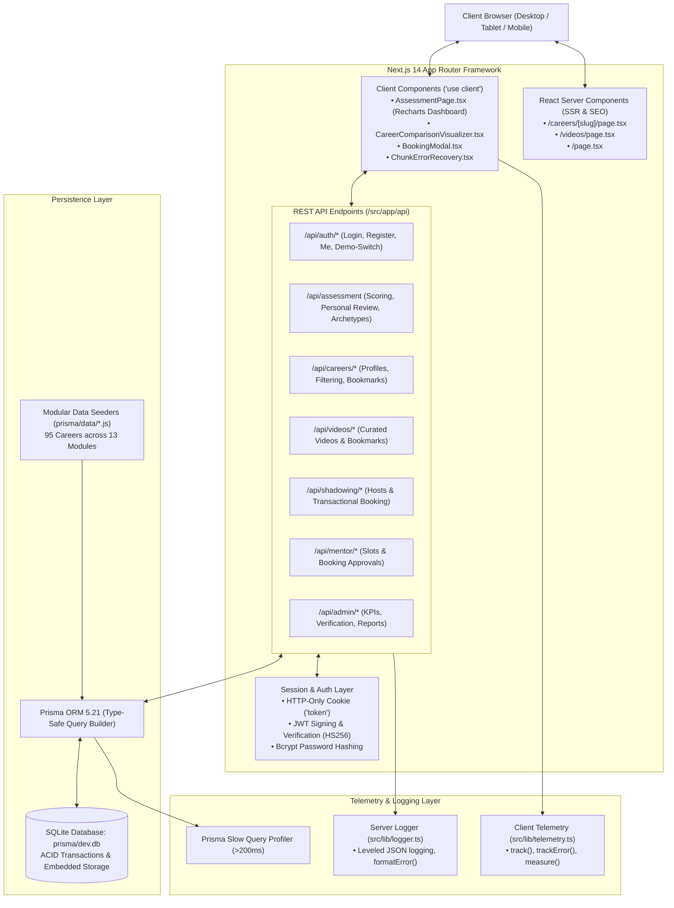
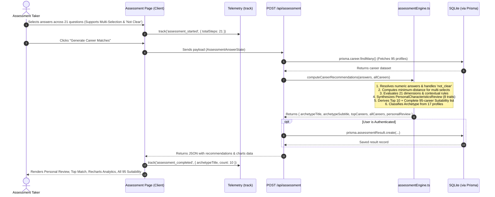
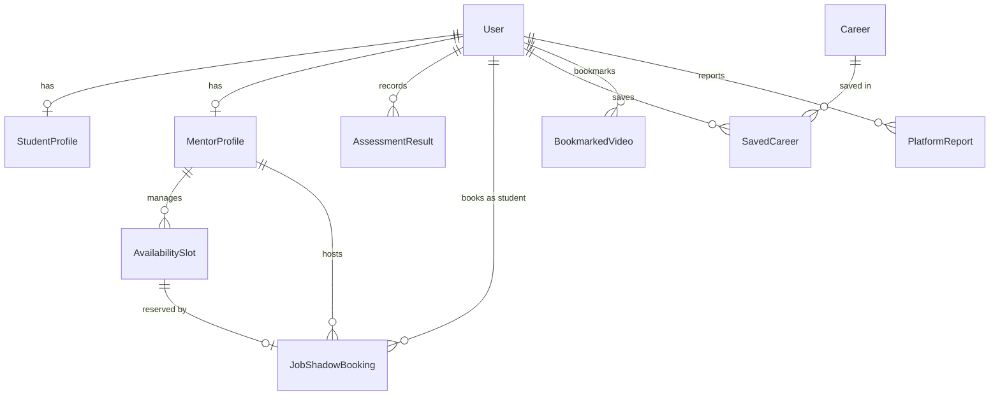

# 🚀 CareerFind — Comprehensive Career Discovery, Exploration & Job Shadowing Platform

[](https://nextjs.org/)
[](https://www.typescriptlang.org/)
[](https://tailwindcss.com/)
[](https://www.prisma.io/)
[](https://www.sqlite.org/)
[](https://recharts.org/)
[](https://opensource.org/licenses/MIT)

> ### *"Don't Just Choose a Career. Experience It Before You Commit."*
> **Core Product Continuum: Explore $\rightarrow$ Experience $\rightarrow$ Evaluate $\rightarrow$ Choose.**

---

## 📖 Table of Contents

1. [Executive Summary](#-executive-summary)
2. [End-to-End System Architecture & Data Flow](#-end-to-end-system-architecture--data-flow)
3. [Environment Variables & Dependencies](#-environment-variables--dependencies)
4. [Database Configuration & Profile Management](#-database-configuration--profile-management)
   - [Database Setup & Prisma ORM](#database-setup--prisma-orm)
   - [Entity-Relationship Diagram](#entity-relationship-diagram)
   - [User Profile Storage & Retrieval](#user-profile-storage--retrieval)
   - [Job Profile Storage, Retrieval & Management (Adding New Careers)](#job-profile-storage-retrieval--management-adding-new-careers)
5. [Assessment Engine & Recommendation Algorithm Workflow](#-assessment-engine--recommendation-algorithm-workflow)
   - [The 21 Assessment Dimensions](#the-21-assessment-dimensions)
   - [End-to-End Recommendation Pipeline Architecture](#end-to-end-recommendation-pipeline-architecture)
   - [Multi-Selection Scoring Mathematics & Minimum-Distance Formulation](#multi-selection-scoring-mathematics--minimum-distance-formulation)
   - [Composite Scoring Formula & 5-Component Weights Breakdown](#composite-scoring-formula--5-component-weights-breakdown)
   - [Contextual Modifiers, Pain Points & Non-Negotiables Engine](#contextual-modifiers-pain-points--non-negotiables-engine)
   - [The 17 Archetype Profiles & Classification Scoring Matrix](#the-17-archetype-profiles--classification-scoring-matrix)
   - [Sub-Specialization Tiebreaker & Calibration Engine](#sub-specialization-tiebreaker--calibration-engine)
   - [Personal Characteristics Review Synthesis](#personal-characteristics-review-synthesis)
   - [Suitability Analysis for All 95 Careers](#suitability-analysis-for-all-95-careers)
6. [Core Application Modules](#-core-application-modules)
   - [Module 1: Interactive 21-Question Career Assessment & Visual Analytics Dashboard](#module-1-interactive-21-question-career-assessment--visual-analytics-dashboard)
   - [Module 2: 95-Career Encyclopedia & 5-Tab Profile Experience](#module-2-95-career-encyclopedia--5-tab-profile-experience)
   - [Module 3: "A Day in the Life" Workday Documentary Library](#module-3-a-day-in-the-life-workday-documentary-library)
   - [Module 4: Job Shadowing Marketplace & Conflict-Free Booking](#module-4-job-shadowing-marketplace--conflict-free-booking)
   - [Module 5: Student Hub & Progress Dashboard](#module-5-student-hub--progress-dashboard)
   - [Module 6: Multi-Career Comparative Evaluation Tool](#module-6-multi-career-comparative-evaluation-tool)
   - [Module 7: Administration & Verification Cockpit](#module-7-administration--verification-cockpit)
7. [Verified API Route Specifications](#-verified-api-route-specifications)
8. [Observability, Telemetry & Structured Logging](#-observability-telemetry--structured-logging)
   - [Client-Side Telemetry Implementation (`src/lib/telemetry.ts`)](#client-side-telemetry-implementation-srclibtelemetryts)
   - [Server-Side Structured Leveled Logger (`src/lib/logger.ts`)](#server-side-structured-leveled-logger-srclibloggerts)
   - [Database Performance & Slow Query Detection (`src/lib/prisma.ts`)](#database-performance--slow-query-detection-srclibprismats)
9. [Debugging, Error Handling & Recovery Architecture](#-debugging-error-handling--recovery-architecture)
   - [Automatic Chunk Load Error Recovery (`ChunkErrorRecovery.tsx`)](#automatic-chunk-load-error-recovery-chunkerrorrecoverytsx)
   - [Global Next.js Error Boundary (`global-error.tsx`)](#global-nextjs-error-boundary-global-errortsx)
   - [Database Diagnostics & Inspection Scripts](#database-diagnostics--inspection-scripts)
   - [Common Debugging Scenarios & Resolution Workflows](#common-debugging-scenarios--resolution-workflows)
10. [Integrations Architecture](#-integrations-architecture)
    - [Recharts Visual Data Layer](#recharts-visual-data-layer)
    - [Prisma ORM & Embedded SQLite](#prisma-orm--embedded-sqlite)
    - [Cookie-Based JWT Authentication](#cookie-based-jwt-authentication)
    - [Privacy-Enhanced YouTube Video Embeds](#privacy-enhanced-youtube-video-embeds)
    - [External Analytics & Observability Sinks](#external-analytics--observability-sinks)
11. [Maintenance Practices & Operational Guide](#-maintenance-practices--operational-guide)
    - [Adding & Modifying Career Profiles](#adding--modifying-career-profiles)
    - [Database Schema Migrations & Seeding](#database-schema-migrations--seeding)
    - [Database Backups & Disaster Recovery](#database-backups--disaster-recovery)
    - [TypeScript Compile-Time Verification](#typescript-compile-time-verification)
    - [Production Build Optimization & Cache Strategy](#production-build-optimization--cache-strategy)
12. [Trust, Safety & In-Person Protocols](#-trust-safety--in-person-protocols)
13. [Pre-Configured Demo Personas](#-pre-configured-demo-personas)
14. [Complete Step-by-Step Local Setup & Execution Guide](#-complete-step-by-step-local-setup--execution-guide)
15. [License](#-license)

---

## 🌟 Executive Summary

**CareerFind** is a production-grade, full-stack career discovery, comparative evaluation, and experiential job shadowing platform engineered to eliminate costly guesswork from educational and professional decision-making. 

Instead of forcing students and career switchers to rely on generic descriptions, CareerFind combines:
- **An Explainable 21-Question Multi-Select Assessment Engine**: Evaluates cognitive aptitudes, technical vs. practical balance, work environment preferences, financial strategies, output mediums, lifestyle dealbreakers, and existing competencies against 95 careers.
- **Visual Analytics Dashboard**: Displays 4 interactive Recharts visualizations (Match Score Bar Chart, Skill Readiness Donut, Salary Trajectory Bars, Multi-Dimension Radar) directly on assessment results.
- **Deep Personal Characteristics Review**: Synthesizes an individualized 8-attribute qualitative diagnostic highlighting strengths, work-style traits, professional inclinations, core drives, and situations to avoid.
- **Complete Suitability Analysis for All 95 Careers**: Full ranking from #1 to #95 with fit categories (*Excellent Fit $\ge$ 85%*, *Good Fit $\ge$ 68%*, *Moderate Fit $\ge$ 48%*, *Low Fit*), skill gap breakdowns, and plain-English rationales.
- **Side-by-Side Multi-Parameter Career Comparison**:
  - Detailed Entry-Level, Mid-Level, and Senior-Level salary ranges directly on top profession cards.
  - Interactive **Career Growth Progression** timelines showing sequential promotions, experience intervals, and role scopes.
  - Grouped **Salary Bands Comparison** bar charts.
  - **Top Skills Needed (Technical + Interpersonal)** with per-profession tag clouds and cross-career skill frequency distribution bar charts.
- **Exhaustive 95-Profession Career Encyclopedia**: Spanning 13 industry domains (*Technology & AI, Business & Brand Management, Creative Arts & Cinema, Fashion & Modeling, Athletics & Sports Coaching, Law & Judiciary, Indian Sovereign Government & Civil Services, Railways & PSUs, Medicine, and Engineering*).
- **High-Trust Job Shadowing Marketplace**: Facilitating virtual and on-site observation sessions with verified industry practitioners, protected by database transactions with collision detection to prevent double-booking.

---

## 🏗️ End-to-End System Architecture & Data Flow

CareerFind is built using a monolithic **Next.js 14 App Router** architecture that balances server-side rendering performance and SEO with dynamic client-side interactivity.

### High-Level System Architecture



### Assessment Submission & Recommendation Flow



---

## 🔐 Environment Variables & Dependencies

### Environment Variables Configuration

CareerFind operates out of the box with zero external third-party dependencies required. Internal defaults enable zero-configuration startup:

| Variable | Required | Default Value | Description |
| :--- | :--- | :--- | :--- |
| `DATABASE_URL` | Optional | `"file:./dev.db"` | SQLite connection string used by Prisma ORM. |
| `JWT_SECRET` | Optional | `careerfind-super-secret-jwt-key-production` | Secret cryptographic key used to sign and verify JSON Web Tokens in HTTP-only session cookies. |
| `PORT` | Optional | `3000` | Local HTTP port for the Next.js server. |
| `NODE_ENV` | Optional | `development` | Runtime environment (`development`, `production`, or `test`). |
| `LOG_LEVEL` | Optional | `debug` (dev) / `info` (prod) | Minimum logging severity (`debug`, `info`, `warn`, `error`). |

Sample `.env` file:
```env
DATABASE_URL="file:./dev.db"
JWT_SECRET="careerfind-super-secret-jwt-key-production"
PORT=3000
NODE_ENV=development
LOG_LEVEL=debug
```

### Dependencies Breakdown

All packages are pinned in [`package.json`](file:///c:/Users/abhi%20vivobook/Desktop/CarrerFind/package.json):

#### Production Dependencies
- **`next` (`14.2.15`)**: App Router, Server Components, Route Handlers, and static rendering optimization.
- **`react` & `react-dom` (`^18.3.1`)**: React UI library.
- **`@prisma/client` (`^5.21.1`)**: Auto-generated type-safe database client.
- **`bcryptjs` (`^2.4.3`)**: Password hashing and salt verification.
- **`jsonwebtoken` (`^9.0.2`)**: JWT token creation, encoding, and cookie verification.
- **`lucide-react` (`^0.453.0`)**: Modern iconography suite.
- **`recharts` (`^2.13.0`)**: Composable declarative charting library for React (Bar, Radar, Donut/Pie charts).
- **`clsx` & `tailwind-merge` (`^2.x`)**: Utility-first CSS class concatenation.

#### Development Dependencies
- **`prisma` (`^5.21.1`)**: Database schema migration and inspection CLI.
- **`typescript` (`^5.x`)**: Compile-time static type analysis.
- **`tailwindcss` (`^3.4.14`)** & **`postcss`**: Utility-first CSS styling engine.
- **`@types/*`**: Type definitions for Node, React, Bcrypt, and JWT.

---

## 🗄️ Database Configuration & Profile Management

### Database Setup & Prisma ORM

CareerFind uses an embedded **SQLite** database (`prisma/dev.db`). This allows full ACID transactional guarantees without configuring external database engines.

```bash
# Push schema changes to the local SQLite database
npx prisma db push

# Regenerate TypeScript Prisma Client after schema edits
npx prisma generate

# Visually inspect and edit records in your browser
npx prisma studio
```

### Entity-Relationship Diagram



### User Profile Storage & Retrieval

- **Registration (`POST /api/auth/register`)**: Receives `name`, `email`, `password`, and `role` (`STUDENT` or `MENTOR`). Hashes passwords with `bcrypt.hash(password, 10)`. Creates `StudentProfile` or `MentorProfile`.
- **Session Authentication**: JWT signed with `{ id, email, role }` (7-day validity) and issued as an `HTTP-Only`, `SameSite=Lax` cookie named `token`.
- **Current User Resolution (`src/lib/auth.ts`)**: `getCurrentUser()` decodes the cookie and fetches user records with linked profiles.

---

### Job Profile Storage, Retrieval & Management (Adding New Careers)

All **95 career profiles** are defined across modular data files in [`prisma/data/`](file:///c:/Users/abhi%20vivobook/Desktop/CarrerFind/prisma/data/):

| Data Module File | Domain Coverage | Career Count |
| :--- | :--- | :--- |
| `techCareers.js` | Core AI, Systems, Software & Cloud Engineering | 8 careers |
| `newTechCareers.js` | Generative AI, Quantum Computing, Climate Tech, Physical AI | 10 careers |
| `specialistCareers.js` | Fintech, Big Data, GTM Engineering, AI Product Management | 8 careers |
| `coreSplitCareers.js` | Full Stack, Frontend, Backend, ML, Data Specialists | 8 careers |
| `businessCareers.js` | Product Management, Strategy Consulting, Venture Capital | 8 careers |
| `financeCareers.js` | Investment Banking, Quantitative Trading, Private Equity | 7 careers |
| `healthCareers.js` | Cardiology, Neurobiology, Clinical Psychology, Biotech | 8 careers |
| `lawGovCareers.js` | Civil Services (IAS/IPS), Armed Forces, High Court Law, Diplomat | 6 careers |
| `builtCareers.js` | Civil, Architecture, Mechanical & Renewable Power Systems | 7 careers |
| `creativeCareers.js` | Film Direction, 3D Animation, Game Design, UX Architecture | 8 careers |
| `aviationMaritimeCareers.js` | Airline Captains, Aerospace Engineering, Maritime Logistics | 5 careers |
| `eduHospitalitySportsCareers.js` | Executive Gastronomy, Sports Science & Coaching | 3 careers |
| `newExtensionCareers.js` | Brand Manager, Athlete, Model, Actor, PSU Executive, Railways | 6 careers |
| **Total** | **All 13 Sectors Combined** | **95 Careers** |

---

## 🧠 Assessment Engine & Recommendation Algorithm Workflow

The CareerFind Recommendation Engine ([`src/lib/assessmentEngine.ts`](file:///c:/Users/abhi%20vivobook/Desktop/CarrerFind/src/lib/assessmentEngine.ts)) implements an **explainable, multi-attribute decision model (MCDM)** combined with **strict constraint programming** and **semantic skill graph mapping**.

### The 21 Assessment Dimensions

Every question is presented in clear, conversational language:

| # | Question Dimension | Internal ID | Data Type | Evaluated Scale / Choices | Purpose & Weight |
| :-: | :--- | :--- | :--- | :--- | :--- |
| **Q1** | **Technical & Engineering Orientation** | `technicalOrientation` | Scaled Spectrum | 1 (Creative/People) to 9 (Deep Code & AI) | Core Aptitude (35% of Component 2) |
| **Q2** | **Workplace Environment** | `workMode` | Multi-Choice | `remote`, `hybrid`, `onsite`, `field`, or `not_clear` | Work Setting (15% of Core Composite) |
| **Q3** | **Output Medium & Tangibility** | `outputMedium` | Scaled Spectrum | 9 (Software), 7 (Physical Builds), 5 (Art/Stage), 2 (Public Law) | Context Modifier ($\pm 8$ to $\pm 24$ pts) |
| **Q4** | **Financial Trajectory & Wealth Mindset** | `financialStrategy` | Scaled Spectrum | 10 (Equity/Upside), 8 (Corporate), 4 (Gov/PSU), 2 (Living Wage) | Context Modifier ($\pm 8$ to $\pm 18$ pts) |
| **Q5** | **Quantitative & Analytical Rigor** | `mathAnalyticalAptitude` | Scaled Spectrum | 1 (Little/No Math) to 9 (Advanced Math/Algorithms) | Core Aptitude (25% of Component 2) |
| **Q6** | **Structure vs. Ambiguity** | `ambiguityTolerance` | Scaled Spectrum | 1 (Strict SOPs) to 9 (Invent from Scratch) | Context Modifier ($\pm 8$ pts) |
| **Q7** | **Leadership & Influence Scope** | `leadershipScope` | Scaled Spectrum | 9 (Executive Command), 7 (Brand), 5 (Coaching), 2 (Solo Craft) | Context Modifier ($\pm 10$ to $\pm 15$ pts) |
| **Q8** | **Human Care & Social Welfare** | `helpingAndHumanImpact` | Scaled Spectrum | 1 (Commercial/Tech) to 10 (Clinical Healing) | Healthcare Category Affinity |
| **Q9** | **Creative Expression & Brand Storytelling** | `creativeDesignAptitude` | Scaled Spectrum | 9 (Cinematic/Screen), 7 (Campaigns), 5 (UX), 2 (Pure Logic) | Creative Category Affinity |
| **Q10** | **Physical Mastery & Tactical Presence** | `physicalDexterityTacticalCraft`| Scaled Spectrum | 9 (Athletics/Tactical), 7 (Industrial), 4 (Active), 2 (Desk) | Tactile Environment Alignment |
| **Q11** | **Technical vs. Practical Work Balance** | `technicalPracticalBalance` | Scaled Spectrum | 1 (100% Practical), 3 (30% Tech / 70% Prac), 6 (60/40), 7 (70/30), 9 (100% Tech) | Practical vs. Theoretical Alignment |
| **Q12** | **Sovereign Service & Public Sector** | `governanceLawPublicService`| Scaled Spectrum | 10 (Civil Services/Defence), 8 (PSUs/Railways), 6 (Law), 2 (Private)| Sovereign & Legal Category Affinity |
| **Q13** | **Lifelong Learning & Tech Velocity** | `continuousLearning` | Scaled Spectrum | 1 (Timeless Craft) to 9 (Rapid Tech Paradigm Shifts) | Core Aptitude (20% of Component 2) |
| **Q14** | **Feedback Cadence & Horizon** | `feedbackHorizon` | Scaled Spectrum | 9 (Immediate Live), 7 (Monthly Sprints), 2 (Multi-Year Legacy) | Context Modifier ($\pm 12$ to $\pm 16$ pts) |
| **Q15** | **Public Visibility & Spotlight** | `publicVisibility` | Scaled Spectrum | 9 (On-Camera/Runway), 7 (Spokesperson/Civil Leader), 2 (Backstage) | Context Modifier ($\pm 14$ to $\pm 22$ pts) |
| **Q16** | **Pressure Dynamics & Crisis Cadence** | `pressureDynamics` | Scaled Spectrum | 9 (Live Crisis/Audience) to 2 (Calm Low-Stress Routine) | Core Aptitude (20% of Component 2) |
| **Q17** | **Lifestyle Preferences & Avoidance Filter** | `lifestylePainPoints` | Multi-Select List | 14 Dealbreakers (commutes, burnout, micromanagement, etc.) | Avoidance Penalties & Relief Boosts |
| **Q18** | **Current Skillset & Practical Foundations** | `existingSkills` | Multi-Select List | 30 Practical Competencies (Coding, CAD, clinical, sports, etc.) | Skill Gap & Domain Bonuses |
| **Q19** | **Target Industry Sectors** | `preferredIndustries` | Multi-Select List | 17 Distinct Industry Sectors | Domain Match (35% of Core Composite) |
| **Q20** | **Core Professional Purpose** | `coreLifeDriver` | Scaled Spectrum | 10 (Nation Building), 8 (Commercial Growth), 6 (Artistic Truth), 4 (Healing) | Context Modifier ($\pm 10$ to $\pm 22$ pts) |
| **Q21** | **Life Non-Negotiables & Dealbreakers**| `nonNegotiables` | Multi-Select List | 12 Hard Standards (Daily fitness, family time, remote freedom, etc.) | Priority Guarantee ($\pm 16$ to $\pm 32$ pts) |

---

### Multi-Selection Scoring Mathematics & Minimum-Distance Formulation

To prevent the **Averaging Fallacy** (where selecting opposite extremes like coding ($9$) and cinema ($2$) results in an unhelpful average of $5.5$), CareerFind uses a **minimum-distance similarity metric**:

$$\text{Similarity}(D, T) = \max\left(0, 1 - \frac{\min_{v \in D} |v - T|}{9}\right)$$

Where:
- $D \subseteq \{1, 2, \dots, 10\}$ is the user's selected choice set.
- $T \in [1, 10]$ is the career profile's target rating.
- $\min_{v \in D} |v - T|$ calculates the shortest distance between any selected preference and the career.
- $9$ is the normalization constant across the 1–10 scale.

Selecting `"not_clear"` applies a neutral, non-penalizing score:
$$\text{Similarity}(\text{not\_clear}, T) = 0.75 \quad (75\%)$$

---

### Composite Scoring Formula & 5-Component Weights Breakdown

$$\text{Total Raw Score} = S_{\text{composite}} + 0.9 \cdot \Delta_{\text{affinity}} + \Delta_{\text{pain}} + \Delta_{\text{ambiguity}} + \Delta_{\text{skills}} + \Delta_{\text{finance}} + \Delta_{\text{medium}} + \Delta_{\text{visibility}} + \Delta_{\text{feedback}} + \Delta_{\text{driver}} + \Delta_{\text{leadership}} + \Delta_{\text{non-negotiables}} + \Delta_{\text{subspec}}$$

#### Core Composite Score Breakdown ($S_{\text{composite}}$):
$$S_{\text{composite}} = 0.35 \cdot S_{\text{domain}} + 0.30 \cdot S_{\text{aptitude}} + 0.15 \cdot S_{\text{workmode}} + 0.10 \cdot S_{\text{salary}} + 0.10 \cdot S_{\text{skills\_ratio}}$$

```
┌────────────────────────────────────────────────────────────────────────┐
│                   CORE COMPOSITE WEIGHT DISTRIBUTION                   │
├──────────────────────────────┬────────┬────────────────────────────────┤
│ Component                    │ Weight │ Evaluates                      │
├──────────────────────────────┼────────┼────────────────────────────────┤
│ 1. Domain & Industry Match   │  35%   │ Q19 Preferred Target Sectors   │
│ 2. Core Cognitive Aptitudes  │  30%   │ Q1 Tech, Q5 Math, Q16 Pressure,│
│                              │        │ Q13 Continuous Learning        │
│ 3. Work Environment & Mode   │  15%   │ Q2 Remote, Hybrid, Field, Site │
│ 4. Salary Trajectory         │  10%   │ Q4 Senior Compensation Ceiling │
│ 5. Skill Gap Ratio           │  10%   │ Q18 Possessed vs Required      │
└──────────────────────────────┴────────┴────────────────────────────────┘
```

---

### Contextual Modifiers, Pain Points & Non-Negotiables Engine

1. **Category Affinities ($\Delta_{\text{affinity}}$)**: Amplifies targeted sectors (Healthcare, Engineering, Creative Arts, Governance, Aviation, Sports).
2. **Lifestyle Pain Points ($\Delta_{\text{pain}}$, Q17)**: Penalizes careers violating quality-of-life preferences (e.g. $-16$ pts for desk-bound roles if user avoids sitting all day; $-18$ pts for constant travel).
3. **Non-Negotiables Guarantee ($\Delta_{\text{non-negotiables}}$, Q21)**: Applies $+16$ to $+22$ pts when conditions are met, and $-25$ to $-32$ pts when violated.

---

### The 17 Archetype Profiles & Classification Scoring Matrix

The engine evaluates 17 archetypes simultaneously and selects the highest scoring archetype:

| Archetype Key | Archetype Title | Dominant Scoring Dimensions |
| :--- | :--- | :--- |
| `systems` | **The Frontier Systems Architect** | Tech, Math, Learning, Code Skills |
| `sovereign_leader`| **The Sovereign Administrator & Nation Builder** | Governance, Nation Building Driver, Admin Skills |
| `brand_architect` | **The Brand Architect & Consumer Visionary** | Creative, Leadership, Visibility, Brand Skills |
| `screen_artist` | **The Cinematic Screen Artist & Magnetic Performer**| Creative, Visibility, Physical, Acting Skills |
| `healer` | **The Compassionate Clinical Healer** | Helping, Healthcare Industry, Medical Skills |
| `tactical` | **The High-Precision Tactical Operator** | Physical, Pressure, Aviation/Maritime, Nav Skills |
| `justice` | **The Guardian of Justice & Sovereign Policy** | Governance, Leadership, Law Industry, Legal Skills |
| `capital` | **The Quantitative Capital Allocator** | Math, Finance Strategy, Finance Skills |
| `creative` | **The Expressive Storyteller & Creative Visionary** | Creative Aptitude, Ambiguity, Art Skills |
| `founder` | **The High-Conviction Venture Founder** | Ambiguity, Finance Upside, Leadership |
| `dealmaker` | **The Strategic Commercial Dealmaker** | Leadership, Sales Skills, Commercial Growth |
| `builder` | **The Master Builder & Infrastructure Architect** | Physical, Math, Built Environment, CAD Skills |
| `craftsman` | **The Master Craftsman & Performance Optimizer** | Physical Dexterity, Tactical Craft, Sports |
| `academic` | **The Knowledge Pioneer & Academic Mentor** | Continuous Learning, Helping, Research Skills |
| `ai_builder` | **The Independent AI Builder & Maker** | Tech Orientation, Ambiguity, Code Skills |
| `mission_engineer`| **The Mission-Driven Climate & Systems Engineer** | CleanTech, Math, Sustainability Driver |
| `public_servant` | **The Dedicated Public Servant & Policy Leader** | Governance, Public Service Driver, Policy Skills |

---

### Personal Characteristics Review Synthesis

The engine synthesizes an individualized **Personal Characteristics Review** (`personalReview`) containing 8 structured attributes:
1. **Summary Paragraph**: Narrative synthesis of cognitive orientation, environment preferences, and motivations.
2. **Key Strengths**: Specific strengths identified from question responses (e.g., *Systems Thinking, Quantitative Reasoning, Crisis Composure*).
3. **Work Style Traits**: Preferred working dynamics and structure.
4. **Professional Inclinations**: Industry areas where the student's background creates natural leverage.
5. **Technical / Practical Balance**: Explicit ratio (e.g., *70% Technical – 30% Practical*).
6. **Work Environment Preference**: Remote, hybrid, on-site, or field orientation.
7. **Core Drives**: Primary fulfillment motivations.
8. **Work Situations to Avoid**: Filtered list of lifestyle conditions the user wants to avoid.

---

### Suitability Analysis for All 95 Careers

Every career in the encyclopedia is ranked from #1 to #95:
- **`rank`**: #1 to #95
- **`fitCategory`**:
  - `Excellent Fit`: Compatibility Score $\ge 85\%$
  - `Good Fit`: Compatibility Score $\ge 68\%$
  - `Moderate Fit`: Compatibility Score $\ge 48\%$
  - `Low Fit`: Compatibility Score $< 48\%$
- **`scoreOutOf10`**: Scaled compatibility rating out of 10.
- **`fitExplanation`**: Personalized explanation detailing why the role matches or where gaps exist.

---

## 📱 Core Application Modules

### MODULE 1: Interactive 21-Question Career Assessment & Visual Analytics Dashboard
*Route: [`/assessment`](http://localhost:3000/assessment)*
- **Question Wizard**: 21-step questionnaire with real-time category tracking, progress bar, multi-select toggles, and "Not Sure / Open" options.
- **Visual Analytics Dashboard**:
  - **Match Score Bar Chart**: Interactive bar chart comparing compatibility across all top 10 career recommendations.
  - **Skill Profile Donut Chart**: Pie chart comparing *Skills You Have* vs. *Skills to Develop* with a calculated career readiness percentage.
  - **Salary Trajectory Bar Chart**: Grouped bar chart displaying Entry, Mid, and Senior salary benchmarks for the top 5 matches.
  - **Multi-Dimension Radar Chart**: Normalized spider chart evaluating top careers across compatibility, work-life balance, learning difficulty, entry salary, and senior salary ceiling.
- **Personal Characteristics Review**: Comprehensive 8-point diagnostic.
- **Suitability Analysis for All 95 Careers**: Expandable list with fit badges, skill tags, and profile navigation.

---

### MODULE 2: 95-Career Encyclopedia & 5-Tab Profile Experience
*Routes: [`/careers`](http://localhost:3000/careers) and [`/careers/[slug]`](http://localhost:3000/careers/ai-ml-engineer)*
- Filterable directory by 13 industry domains, salary sliders, remote flexibility, and keyword search.
- **5-Tab Navigation System** on every single profile:
  1. **Overview:** Summary, key metrics, required education, advantages & disadvantages.
  2. **A Day in the Life:** Hour-by-hour chronological schedule, workload split (Execution, Collaboration, Triage, Strategy), and video documentaries.
  3. **Job Shadowing:** 4 learning pillars (Observation, Tool Inspection, Q&A Reality Check, Resume Review), verified host cards with 1-click booking, and NDA protocols.
  4. **Skills & Roadmap:** Essential technical skills, soft skills, tools stack, and career progression roadmap.
  5. **Compensation & Growth:** Entry, mid, and senior salary bands, 10-year projected demand growth, and international opportunities.

---

### MODULE 3: "A Day in the Life" Workday Documentary Library
*Route: [`/videos`](http://localhost:3000/videos)*
- 25 curated documentaries powered by privacy-enhanced YouTube embeds (`youtube-nocookie.com`).
- Features duration tags, seniority levels, location badges, and structured key takeaways checklists.
- Search and category filters with 1-click personal watchlist bookmarking.

---

### MODULE 4: Job Shadowing Marketplace & Conflict-Free Booking
*Route: [`/shadowing`](http://localhost:3000/shadowing)*
- Connects students with 12 verified industry practitioners across tech, clean energy, culinary arts, brand management, acting, athletics, and government.
- Availability slot selection for **Virtual** and **In-Person** sessions.
- Interactive modal booking form capturing learning goals and background.
- Protected by Prisma database transactions with collision detection to prevent double-booking.

---

### MODULE 5: Student Hub & Progress Dashboard
*Route: [`/student/dashboard`](http://localhost:3000/student/dashboard)*
- Centralized tracking interface for students.
- Displays exploration progress percentage, latest assessment archetype, upcoming and completed shadowing sessions, and bookmarked careers and videos.

---

### MODULE 6: Multi-Career Comparative Evaluation Tool
*Route: [`/student/compare`](http://localhost:3000/student/compare)*
- Compare 2 to 4 professions side by side.
- **Dedicated Salary Ranges on Profession Cards**:
  - **Entry Level:** `$entrySalaryMin`k – `$entrySalaryMax`k
  - **Mid Level:** `$midSalaryMin`k – `$midSalaryMax`k
  - **Senior Level:** `$seniorSalaryMin`k – `$seniorSalaryMax`k+
- **Dimension Breakdown**: 8 normalized quantitative dimensions plus **Career Growth Progression** timelines showing sequential promotions, years of experience, and role scopes.
- **Salary Bands Comparison Chart**: Grouped bar chart comparing compensation across career stages side-by-side.
- **Top Skills Needed (Technical + Interpersonal)**:
  - Per-career skill cards with technical (cyan) and interpersonal (rose) badges.
  - Cross-career skill frequency distribution bar charts highlighting shared requirements.
- **Qualitative Matrix**: Work mode, required education, future demand outlook, and international mobility.

---

### MODULE 7: Administration & Verification Cockpit
*Route: [`/admin/dashboard`](http://localhost:3000/admin/dashboard)*
- Platform KPIs: Total registered users, verified mentors, active bookings, and moderation reports.
- Mentor verification queue: Review submitted credentials, corporate emails, and approve/reject applications with notes.
- Moderation reports monitor with 1-click resolution.

---

## 📡 Verified API Route Specifications

Every endpoint is verified in [`src/app/api/`](file:///c:/Users/abhi%20vivobook/Desktop/CarrerFind/src/app/api):

| Method | Endpoint | Description | Role / Auth |
| :--- | :--- | :--- | :--- |
| `GET` | `/api/auth/me` | Retrieve currently authenticated user session and profile | Public / Any |
| `POST` | `/api/auth/login` | Authenticate user with email and password | Public |
| `POST` | `/api/auth/register` | Create a new student or mentor account | Public |
| `POST` | `/api/auth/logout` | Clear HTTP-only session cookie | Authenticated |
| `POST` | `/api/auth/demo-switch` | Instant 1-click persona switch for evaluation | Public / Demo |
| `POST` | `/api/assessment` | Score 21-question assessment and return recommendations & review | Public / Student |
| `GET` | `/api/careers` | Filter, search, and list career profiles | Public |
| `POST` | `/api/careers/save` | Toggle career bookmark in student profile | Student |
| `GET` | `/api/videos` | Query curated Day-in-the-Life video library | Public |
| `POST` | `/api/videos` | Submit community video recommendation | Authenticated |
| `POST` | `/api/videos/bookmark` | Toggle video watchlist bookmark | Student |
| `GET` | `/api/shadowing/professionals` | Query verified mentors and published open slots | Public |
| `POST` | `/api/shadowing/book` | Book a shadowing slot with transaction conflict lock | Student |
| `GET` | `/api/mentor/bookings` | View incoming and scheduled shadowing sessions | Mentor |
| `PATCH`| `/api/mentor/bookings` | Approve, reject, or submit feedback on bookings | Mentor |
| `GET` | `/api/mentor/slots` | Fetch mentor's published availability slots | Mentor |
| `POST` | `/api/mentor/slots` | Publish a new virtual or in-person time slot | Mentor |
| `DELETE`| `/api/mentor/slots` | Remove an unbooked time slot | Mentor |
| `GET` | `/api/student/dashboard` | Aggregate student metrics, bookings, and saved profiles | Student |
| `GET` | `/api/admin/overview` | Fetch platform KPIs, verification queue, and bookings | Admin |
| `POST` | `/api/admin/verify-mentor` | Approve or reject mentor verification credentials | Admin |
| `GET` | `/api/admin/reports` | Fetch open platform moderation reports | Admin |
| `PATCH`| `/api/admin/reports` | Resolve or dismiss moderation reports | Admin |

---

## 📊 Observability, Telemetry & Structured Logging

CareerFind features a unified observability architecture built for production debuggability, error tracking, and scale without external vendor lock-in.

### Client-Side Telemetry Implementation (`src/lib/telemetry.ts`)

Lightweight, browser-safe telemetry utility:
```ts
import { track, trackError, measure, measureSync } from '@/lib/telemetry';

// 1. Track named events with custom metadata
track('assessment_started', { totalSteps: 21 });
track('compare_career_added', { slug: 'ai-ml-engineer' });

// 2. Track errors with sanitized context
trackError(err, { component: 'CareerComparisonVisualizer', action: 'render' });

// 3. Measure async execution duration
const data = await measure('fetch_recommendations', () => fetchRecommendations());
```

#### Event Catalog:
- `assessment_started`: Triggered when question 1 is answered.
- `assessment_completed`: Emitted with `archetypeTitle` and recommendations count.
- `assessment_restarted`: User resets assessment.
- `compare_viewed`: Compare page accessed.
- `compare_career_added` / `compare_career_removed`: Careers modified in comparison tool.
- `booking_submitted` / `booking_confirmed`: Shadowing reservations.
- `error_encountered`: Centralized client-side error capture.

### Server-Side Structured Leveled Logger (`src/lib/logger.ts`)

- **Structured JSON-Ready Logging**: Emits timestamped, leveled logs (`debug`, `info`, `warn`, `error`) tagged by module name (e.g. `[API:Assessment]`, `[Prisma:SlowQuery]`, `[Auth]`).
- **Configurable Severity**: Controlled via the `LOG_LEVEL` environment variable (`debug`, `info`, `warn`, `error`). In production, defaults to `info` and higher; in development, captures full `debug` traces.
- **Safe Error Normalization**: The `formatError(err)` helper cleanly extracts error names, messages, and dev-only stack traces while preventing secret leaks.

```ts
import { logger, formatError } from '@/lib/logger';
const log = logger('API:Assessment');

log.info('Recommendation request received', { dimensionsCount: 21 });
log.error('Assessment computation failed', { error: formatError(err) });
```

### Database Performance & Slow Query Detection (`src/lib/prisma.ts`)

Integrated directly into the Prisma Client singleton:
```ts
// In development, automatically flags queries exceeding 200ms
client.$on('query', (e: { query: string; duration: number }) => {
  if (e.duration > 200) {
    log.warn('Slow Prisma query detected', {
      query: e.query,
      duration_ms: e.duration,
    });
  }
});
```

---

## 🛠️ Debugging, Error Handling & Recovery Architecture

### Automatic Chunk Load Error Recovery (`ChunkErrorRecovery.tsx`)

Next.js single-page applications can experience `ChunkLoadError` when a new build is deployed or local cache is stale. CareerFind includes a global recovery listener in [`src/components/ChunkErrorRecovery.tsx`](file:///c:/Users/abhi%20vivobook/Desktop/CarrerFind/src/components/ChunkErrorRecovery.tsx):
- Detects `ChunkLoadError` and script loading failures.
- Logs the error via `trackError(err, { context: 'ChunkLoadErrorRecovery' })`.
- Performs an automated session-debounced reload (max once per 10 seconds) to fetch updated chunks cleanly.

### Global Next.js Error Boundary (`global-error.tsx`)

A root error boundary in [`src/app/global-error.tsx`](file:///c:/Users/abhi%20vivobook/Desktop/CarrerFind/src/app/global-error.tsx) catches unhandled exceptions across server components:
- Logs error digest and details to telemetry.
- Renders an accessible fallback UI with **"Try Again"** (state reset) and **"Reload Page"** actions.

### Database Diagnostics & Inspection Scripts

CareerFind includes built-in scripts to inspect and repair database state:
```bash
# Verify SQLite table counts and database connectivity
node check_db.js

# Launch visual database browser
npx prisma studio
```

### Common Debugging Scenarios & Resolution Workflows

#### 1. Stale Git Index Lock on Windows
- **Symptom:** `fatal: Unable to create '.git/index.lock': Permission denied`.
- **Resolution:** Remove the stale lock file using PowerShell:
  ```powershell
  Remove-Item -Force .git/index.lock -ErrorAction SilentlyContinue
  ```

#### 2. Port Collision (`EADDRINUSE: 3000`)
- **Symptom:** `Error: listen EADDRINUSE: address already in use :::3000`.
- **Resolution:** Start Next.js on an alternate port:
  ```bash
  npx next dev -p 3001
  ```

#### 3. Database Schema Drift
- **Symptom:** Missing columns or relation mismatch errors in Prisma queries.
- **Resolution:**
  ```bash
  npx prisma db push
  npx prisma generate
  ```

---

## 🔌 Integrations Architecture

### Recharts Visual Data Layer
- **Responsive Design**: All visualizations wrap in `<ResponsiveContainer width="100%" height={...}>`.
- **Custom Tooltips**: Styled tooltips with dark slate themes and formatted currency/percentages.
- **Accessible Colors**: Color palette designed for contrast and readability across dark backgrounds.

### Prisma ORM & Embedded SQLite
- **Embedded Storage**: Stored at `prisma/dev.db`.
- **Singleton Connection Pool**: Attached to `globalThis` in development to prevent connection exhaustion during hot module reloading.

### Cookie-Based JWT Authentication
- **HTTP-Only Cookies**: Tokens cannot be accessed via client-side JavaScript (`document.cookie`), mitigating XSS token theft.
- **SameSite Protection**: Set to `Lax` to prevent Cross-Site Request Forgery (CSRF).

### Privacy-Enhanced YouTube Video Embeds
- Embeds load from `https://www.youtube-nocookie.com/embed/{id}`.
- Prevents YouTube from setting tracking cookies until the user plays the video.

### External Analytics & Observability Sinks
Both `logger.ts` and `telemetry.ts` feature clean single-dispatch functions:
- **Telemetry (`src/lib/telemetry.ts`)**: Replace `dispatch()` to route events to PostHog, Mixpanel, Datadog RUM, or Amplitude.
- **Logging (`src/lib/logger.ts`)**: Replace `emit()` to forward structured logs to Datadog, Sentry, Axiom, or Logtail.

---

## 🔧 Maintenance Practices & Operational Guide

### Adding & Modifying Career Profiles
1. Open the relevant file in `prisma/data/` (e.g. `prisma/data/techCareers.js`).
2. Define the new profile ensuring all 26 required fields are provided.
3. Sync the database:
   ```bash
   node prisma/seed.js
   ```

### Database Schema Migrations & Seeding
```bash
# Push schema updates
npx prisma db push

# Re-seed test mentors, careers, and videos
node prisma/seed.js
```

### Database Backups & Disaster Recovery
Because CareerFind uses SQLite, backing up the database requires copying the single file:
```bash
# Windows PowerShell Backup
Copy-Item "prisma\dev.db" "prisma\dev.db.backup"

# Linux / macOS Backup
cp prisma/dev.db prisma/dev.db.backup
```

### TypeScript Compile-Time Verification
Run type analysis across all pages, components, and libraries:
```bash
npx tsc --noEmit
```

### Production Build Optimization & Cache Strategy
```bash
# Clean build and compile production bundle
npm run build

# Start production server
npm run start
```

---

## 🛡️ Trust, Safety & In-Person Protocols

1. **Host Verification Protocol**: Practitioners must verify professional identity and credentials before receiving verified status.
2. **Approved Environments Only**: In-person shadowing occurs exclusively in authorized corporate or institutional workspaces.
3. **Confidentiality & Non-Disclosure (NDA)**: Digital agreements prevent unauthorized disclosure of proprietary systems or client data.
4. **Moderation & Incident Escalation**: Direct administrative review workflows for safety reports.

---

## 👥 Pre-Configured Demo Personas

CareerFind includes a 1-Click Role Switcher in the top navigation bar:

| Persona | Name | Role & Title | Pre-Seeded Email | Password |
| :--- | :--- | :--- | :--- | :--- |
| 🎓 **Student** | **Alex Chen** | Undergraduate CS & CogSci @ UC Berkeley | `alex.chen@university.edu` | `password123` |
| 💼 **AI Mentor** | **Dr. Priya Sharma** | Staff AI Engineer @ Google DeepMind | `priya.sharma@deepmind.com` | `password123` |
| 💼 **FDE Mentor** | **Marcus Vance** | Lead Forward Deployed Engineer @ Palantir | `marcus.vance@palantir.com` | `password123` |
| 💼 **Brand Mentor** | **Aarav Mehta** | Global Brand Director @ Unilever Ecosystem | `aarav.brand@unilever.com` | `password123` |
| 💼 **Actor Mentor** | **Natasha Roy** | Screen Actor & Voice Artist @ Motion Pictures | `natasha.actor@cinema.com` | `password123` |
| 💼 **Sports Coach**| **Vikram Rathore** | High-Performance Athletic Director | `vikram.coach@athletics.org` | `password123` |
| 💼 **Railways Host**| **Rajeshwar Singh** | Principal Operations Director Retd. @ IRMS | `rajeshwar.irms@railways.gov.in` | `password123` |
| 🛡️ **Platform Admin**| **Sarah Miller** | Head of Trust & Safety @ CareerFind | `admin@careerfind.com` | `password123` |

---

## 💻 Complete Step-by-Step Local Setup & Execution Guide

### Prerequisites
- **Node.js**: `v18.17.0+`, `v20.x`, or `v22.x`
- **Package Manager**: `npm` or `pnpm`
- **Git**: Installed and configured on your PATH

### Step 1: Clone the Repository
```bash
git clone https://github.com/AbhinavPandey12/CarrerFind---Best-Carrer-for-You.git
cd CarrerFind---Best-Carrer-for-You
```

### Step 2: Install Project Dependencies
```bash
npm install
```

### Step 3: Initialize SQLite Database & Push Prisma Schema
```bash
npx prisma db push
```

### Step 4: Seed Comprehensive Data
```bash
node prisma/seed.js
```

### Step 5: Start the Development Server
```bash
npm run dev
```
Open **[http://localhost:3000](http://localhost:3000)** in your browser.

### Step 6: Verify TypeScript & Build for Production
```bash
# Verify static typing
npx tsc --noEmit

# Compile production bundle
npm run build
```

---

## 📄 License

This project is licensed under the [MIT License](LICENSE).
