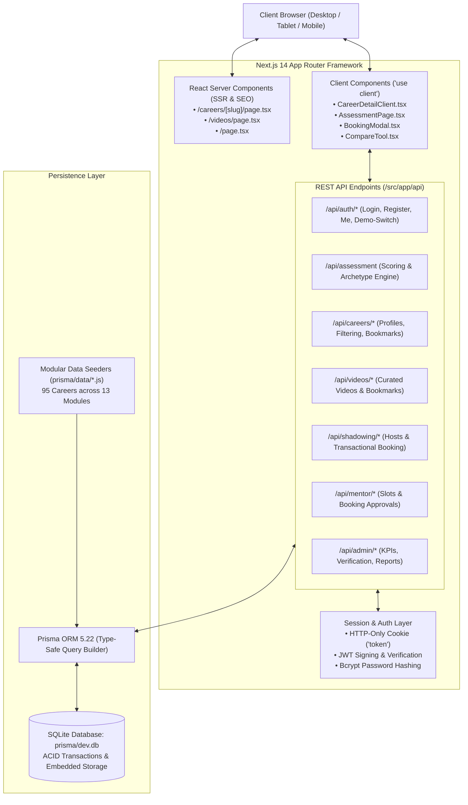
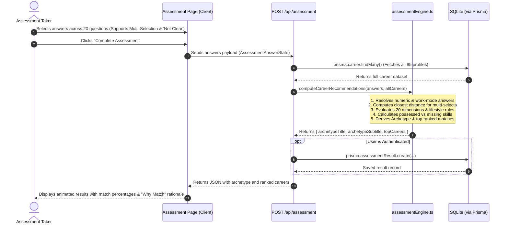
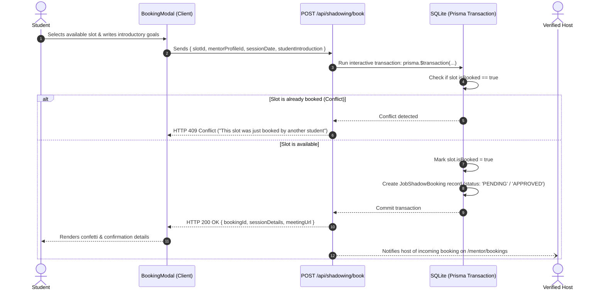
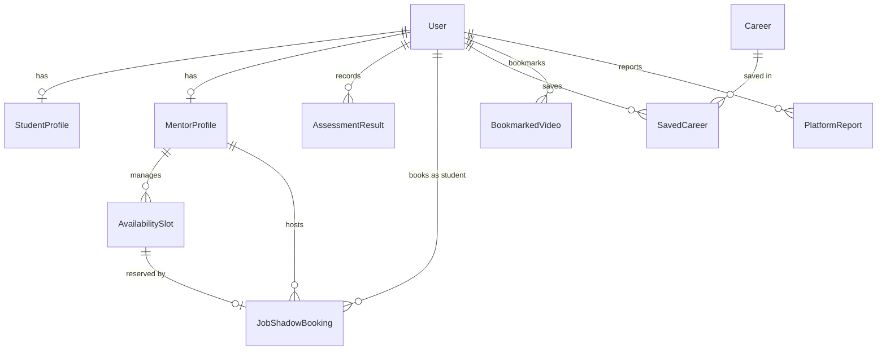
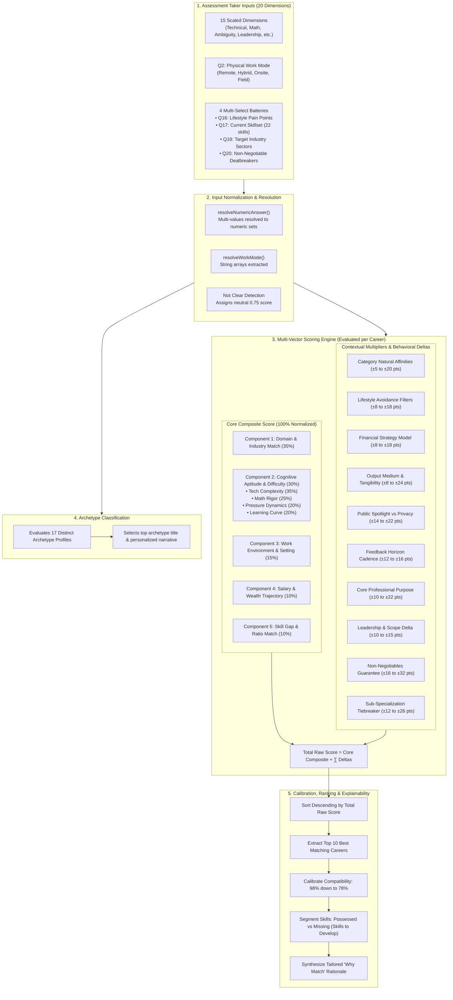

# 🚀 CareerFind — Comprehensive Career Discovery, Exploration & Job Shadowing Platform

[](https://nextjs.org/)
[](https://www.typescriptlang.org/)
[](https://tailwindcss.com/)
[](https://www.prisma.io/)
[](https://www.sqlite.org/)
[](https://opensource.org/licenses/MIT)

> ### *"Don't Just Choose a Career. Experience It Before You Commit."*
> **Core Product Continuum: Explore $\rightarrow$ Experience $\rightarrow$ Evaluate $\rightarrow$ Choose.**

---

## 📖 Table of Contents

1. [Executive Summary](#-executive-summary)
2. [End-to-End System Architecture & Data Flow](#-end-to-end-system-architecture--data-flow)
3. [Environment Variables & Dependencies](#-environment-variables--dependencies)
4. [Database Configuration & Profile Management](#-database-configuration--profile-management)
   - [Database Setup & Prisma ORM](#database-setup--prisma-orm)
   - [Entity-Relationship Diagram](#entity-relationship-diagram)
   - [User Profile Storage & Retrieval](#user-profile-storage--retrieval)
   - [Job Profile Storage, Retrieval & Management (Adding New Careers)](#job-profile-storage-retrieval--management-adding-new-careers)
5. [Assessment Engine & Recommendation Algorithm Workflow](#-assessment-engine--recommendation-algorithm-workflow)
   - [The 20 Assessment Dimensions](#the-20-assessment-dimensions)
   - [End-to-End Recommendation Pipeline Architecture](#end-to-end-recommendation-pipeline-architecture)
   - [Multi-Selection Scoring Mathematics & Minimum-Distance Formulation](#multi-selection-scoring-mathematics--minimum-distance-formulation)
   - [Composite Scoring Formula & 5-Component Weights Breakdown](#composite-scoring-formula--5-component-weights-breakdown)
   - [Contextual Modifiers, Pain Points & Non-Negotiables Engine](#contextual-modifiers-pain-points--non-negotiables-engine)
   - [The 17 Archetype Profiles & Classification Scoring Matrix](#the-17-archetype-profiles--classification-scoring-matrix)
   - [Sub-Specialization Tiebreaker & Calibration Engine](#sub-specialization-tiebreaker--calibration-engine)
   - [Explainability, Skill Gap Analysis & 'Why Match' Synthesis](#explainability-skill-gap-analysis--why-match-synthesis)
6. [Core Application Modules](#-core-application-modules)
   - [Module 1: Interactive Career Assessment](#module-1-interactive-career-assessment)
   - [Module 2: 95-Career Encyclopedia & 5-Tab Profile Experience](#module-2-95-career-encyclopedia--5-tab-profile-experience)
   - [Module 3: "A Day in the Life" Workday Documentary Library](#module-3-a-day-in-the-life-workday-documentary-library)
   - [Module 4: Job Shadowing Marketplace & Conflict-Free Booking](#module-4-job-shadowing-marketplace--conflict-free-booking)
   - [Module 5: Student Hub & Progress Dashboard](#module-5-student-hub--progress-dashboard)
   - [Module 6: Multi-Career Comparative Evaluation Tool](#module-6-multi-career-comparative-evaluation-tool)
   - [Module 7: Administration & Verification Cockpit](#module-7-administration--verification-cockpit)
7. [Verified API Route Specifications](#-verified-api-route-specifications)
8. [Trust, Safety & In-Person Protocols](#-trust-safety--in-person-protocols)
9. [Pre-Configured Demo Personas](#-pre-configured-demo-personas)
10. [Complete Step-by-Step Local Setup & Execution Guide](#-complete-step-by-step-local-setup--execution-guide)
11. [Observability, Telemetry & Structured Logging](#-observability-telemetry--structured-logging)

---

## 🌟 Executive Summary

**CareerFind** is a production-grade, full-stack career discovery and experiential shadowing platform designed to eliminate the costly guesswork from education and career decision-making. 

Instead of forcing students and professionals to rely on idealized job descriptions, CareerFind combines:
- **An Explainable 20-Question Multi-Select Assessment Engine** that maps personal cognitive strengths, quantitative comfort, work modes, and non-negotiables to compatibility ratings across all careers.
- **An Exhaustive 95-Profession Career Encyclopedia** spanning 13 industry domains (*Technology & AI, Business & Brand Management, Creative Arts & Cinema, Fashion & Modeling, Athletics & Sports Coaching, Law & Judiciary, Indian Sovereign Government & Civil Services, Railways & PSUs, Medicine, and Engineering*).
- **A 5-Tab Interactive Profile Experience** on every career page featuring **Overview**, **A Day in the Life** (hour-by-hour chronological schedule, workload split, and documentary videos), **Job Shadowing** (4 learning pillars, verified hosts, and 1-click booking), **Skills & Roadmap**, and **Compensation & Growth**.
- **A High-Trust Job Shadowing Marketplace** facilitating virtual and on-site observation sessions with verified industry practitioners, protected by database-level double-booking prevention.
- **Side-by-Side Multi-Parameter Career Comparison** evaluating up to 4 roles across 8 quantitative and qualitative dimensions simultaneously.

---

## 🏗️ End-to-End System Architecture & Data Flow

CareerFind is engineered with a modern, monolithic Next.js App Router architecture that balances server-side rendering performance with rich client-side interactivity.

### High-Level System Architecture



### Assessment Submission & Recommendation Flow



### Job Shadowing Booking & Conflict-Locking Flow



---

## 🔐 Environment Variables & Dependencies

### Environment Variables Configuration

The project operates out of the box with zero required external third-party services. The configuration is loaded via environment variables with safe internal defaults:

| Variable | Required | Default Value | Description |
| :--- | :--- | :--- | :--- |
| `DATABASE_URL` | Optional | `"file:./dev.db"` | SQLite connection string used by Prisma. Set to `file:./dev.db` located inside `prisma/`. |
| `JWT_SECRET` | Optional | `careerfind-super-secret-jwt-key-production` | Secret cryptographic key used to sign and verify JSON Web Tokens in HTTP-only session cookies. |
| `PORT` | Optional | `3000` | Local HTTP port for the Next.js server. |
| `NODE_ENV` | Optional | `development` | Runtime environment (`development`, `production`, or `test`). |

To customize these, create a `.env` file in the root directory:

```env
DATABASE_URL="file:./dev.db"
JWT_SECRET="your-custom-secure-jwt-secret-here"
PORT=3000
NODE_ENV=development
```

### Dependencies Breakdown

All packages are strictly pinned in [`package.json`](file:///c:/Users/abhi%20vivobook/Desktop/CarrerFind/package.json):

#### Production Dependencies
- **`next` (`14.2.15`)**: Core React framework utilizing App Router, Server Components, and API routes.
- **`react` & `react-dom` (`^18.x`)**: Core UI component library.
- **`@prisma/client` (`^5.22.0`)**: Auto-generated type-safe database client.
- **`bcryptjs` (`^2.4.3`)**: Password salt generation and hash verification.
- **`jsonwebtoken` (`^9.0.2`)**: JWT token creation, encoding, and cookie verification.
- **`lucide-react` (`^0.454.0`)**: Modern SVG iconography.
- **`clsx` & `tailwind-merge` (`^2.x`)**: Dynamic CSS class composition.
- **`canvas-confetti` (`^1.9.4`)**: Visual celebratory feedback on assessment completion and shadowing bookings.

#### Development Dependencies
- **`prisma` (`^5.22.0`)**: Prisma CLI for database migrations, schema pushing, and studio inspector.
- **`typescript` (`^5.x`)**: Strict compile-time static type analysis.
- **`tailwindcss` (`^3.4.x`)** & **`postcss`**: Utility-first CSS styling engine.
- **`@types/*`**: Comprehensive TypeScript definitions for Node, React, Bcrypt, and JWT.

---

## 🗄️ Database Configuration & Profile Management

### Database Setup & Prisma ORM

The application uses an embedded **SQLite** database (`prisma/dev.db`). This makes CareerFind completely self-contained with zero Docker or external database service requirements.

Key Prisma commands:
```bash
# Push schema changes to the local SQLite database without creating heavy SQL migration files
npx prisma db push

# Re-generate the TypeScript Prisma Client after schema changes
npx prisma generate

# Launch Prisma Studio to visually inspect and edit records in your browser
npx prisma studio
```

### Entity-Relationship Diagram



### User Profile Storage & Retrieval

1. **User Registration (`POST /api/auth/register`):**
   - Receives `name`, `email`, `password`, and `role` (`STUDENT` or `MENTOR`).
   - Hashes password using `bcrypt.hash(password, 10)`.
   - Creates the parent `User` record.
   - If `role === 'STUDENT'`, creates a linked `StudentProfile` storing `academicLevel`, `majorOrField`, `skillsPossessed`, and `preferredWorkMode`.
   - If `role === 'MENTOR'`, creates a linked `MentorProfile` with `company`, `title`, `industry`, `experienceYears`, starting with `verificationStatus: 'PENDING'`.

2. **Session Authentication & Profile Retrieval:**
   - On successful login, signs a JWT containing `{ id, email, role }` with a 7-day expiration and sets it as an `HTTP-Only`, `SameSite=Lax` cookie named `token`.
   - The helper `getCurrentUser()` in [`src/lib/auth.ts`](file:///c:/Users/abhi%20vivobook/Desktop/CarrerFind/src/lib/auth.ts) decodes the cookie and retrieves the full profile:
     ```ts
     const user = await prisma.user.findUnique({
       where: { id: decoded.id },
       include: { studentProfile: true, mentorProfile: true },
     });
     ```
   - Allows clean Role-Based Access Control (RBAC) across student, mentor, and administrative routes.

---

### Job Profile Storage, Retrieval & Management (Adding New Careers)

All **95 career profiles** in CareerFind are stored in the `Career` table and defined across modular JavaScript data files in [`prisma/data/`](file:///c:/Users/abhi%20vivobook/Desktop/CarrerFind/prisma/data/):

| Data Module File | Domain Coverage | Career Count |
| :--- | :--- | :--- |
| `techCareers.js` | Core AI, Systems, Software & Cloud Engineering | 8 careers |
| `newTechCareers.js` | Generative AI, Quantum Computing, Climate Tech, Physical AI | 10 careers |
| `specialistCareers.js` | Fintech, Big Data, GTM Engineering, AI Product Management | 8 careers |
| `coreSplitCareers.js` | Full Stack, Frontend, Backend, ML, Data Specialists | 8 careers |
| `businessCareers.js` | Product Management, Strategy Consulting, Venture Capital | 8 careers |
| `financeCareers.js` | Investment Banking, Quantitative Trading, Private Equity | 7 careers |
| `healthCareers.js` | Cardiology, Neurobiology, Clinical Psychology, Biotech | 8 careers |
| `lawGovCareers.js` | Civil Services (IAS/IPS), Armed Forces, High Court Law, Diplomat | 6 careers |
| `builtCareers.js` | Civil, Architecture, Mechanical & Renewable Power Systems | 7 careers |
| `creativeCareers.js` | Film Direction, 3D Animation, Game Design, UX Architecture | 8 careers |
| `aviationMaritimeCareers.js` | Airline Captains, Aerospace Engineering, Maritime Logistics | 5 careers |
| `eduHospitalitySportsCareers.js` | Executive Gastronomy, Sports Science & Coaching | 3 careers |
| `newExtensionCareers.js` | Brand Manager, Athlete, Model, Actor, PSU Executive, Railways | 6 careers |
| **Total** | **All 13 Sectors Combined** | **95 Careers** |

#### Schema Definition of a Career Profile
Each career conforms to the `Career` model in `prisma/schema.prisma` across 26 rich fields:
```prisma
model Career {
  id                          String   @id @default(cuid())
  slug                        String   @unique
  title                       String
  category                    String   // e.g. "Technology & Engineering", "Law & Government"
  industry                    String
  shortDescription            String
  overview                    String
  dailyResponsibilities       String   // JSON string array
  dayInLife                   String   // Formatted chronological workday schedule
  typicalWorkEnvironment      String   // Remote, Hybrid, Office, Lab, Field
  requiredEducation           String
  essentialTechSkills         String   // JSON string array
  essentialSoftSkills         String   // JSON string array
  toolsAndTechnologies        String   // JSON string array
  entrySalaryMin              Int      // USD in thousands (e.g. 85 = $85,000)
  entrySalaryMax              Int
  midSalaryMin                Int
  midSalaryMax                Int
  seniorSalaryMin             Int
  seniorSalaryMax             Int
  learningDifficulty          Int      // 1-10 scale
  entryJobDifficulty          Int      // 1-10 scale
  technicalComplexity         Int      // 1-10 scale
  mathRequirements            Int      // 1-10 scale
  workPressure                Int      // 1-10 scale
  workLifeBalance             Int      // 1-10 scale
  remoteOpportunities         Int      // 1-10 scale
  careerStability             Int      // 1-10 scale
  futureDemandScore           Int      // 1-10 scale
  futureDemandOutlook         String   // e.g. "26% projected 10-year growth"
  growthPotential             Int      // 1-10 scale
  internationalOpportunities  String
  advantages                  String   // JSON string array
  disadvantages               String   // JSON string array
  careerProgressionRoadmap    String   // JSON string array of stages
  iconName                    String   @default("Briefcase")
  featured                    Boolean  @default(false)
  createdAt                   DateTime @default(now())
}
```

#### How to Add a New Career Profile to the Backend

To add a new career profile, follow these simple steps:

1. **Add the Career Definition:**
   Open the relevant file in `prisma/data/` (or create a new module and export it in `prisma/data/index.js`). Define the profile with its unique slug and all 26 fields:
   ```javascript
   {
     slug: "renewable-energy-director",
     title: "Renewable Energy Director",
     category: "Engineering & Built Environment",
     industry: "CleanTech & Energy",
     shortDescription: "Directing utility-scale solar, wind, and battery energy transition programs.",
     overview: "Full overview text...",
     dailyResponsibilities: JSON.stringify(["Grid interconnection modeling", "Turbine procurement", "EPC audits"]),
     dayInLife: "08:30 AM - Grid telemetry audit\n10:30 AM - EPC contractor standup\n02:00 PM - Environmental regulatory hearing\n05:30 PM - Capital allocation debrief",
     typicalWorkEnvironment: "Hybrid (Site visits + Remote design)",
     requiredEducation: "B.Tech in Electrical/Mechanical Engineering + PE License",
     essentialTechSkills: JSON.stringify(["PSCAD", "Power Systems", "Grid Interconnection"]),
     essentialSoftSkills: JSON.stringify(["Stakeholder Negotiation", "Risk Mitigation"]),
     toolsAndTechnologies: JSON.stringify(["ETAP", "MATLAB", "AutoCAD Electrical"]),
     entrySalaryMin: 80,
     entrySalaryMax: 110,
     midSalaryMin: 130,
     midSalaryMax: 180,
     seniorSalaryMin: 200,
     seniorSalaryMax: 290,
     learningDifficulty: 8,
     entryJobDifficulty: 7,
     technicalComplexity: 8,
     mathRequirements: 8,
     workPressure: 7,
     workLifeBalance: 7,
     remoteOpportunities: 6,
     careerStability: 9,
     futureDemandScore: 9,
     futureDemandOutlook: "32% projected 10-year growth (Much faster than average)",
     growthPotential: 9,
     internationalOpportunities: "High global demand across the US, EU, and India.",
     advantages: JSON.stringify(["High mission fulfillment", "Government-backed incentives"]),
     disadvantages: JSON.stringify(["Protracted regulatory review cycles"]),
     careerProgressionRoadmap: JSON.stringify(["Junior Project Engineer", "Lead Systems Engineer", "Engineering Director"]),
     iconName: "Zap",
     featured: true,
   }
   ```

2. **Sync the Database:**
   Run the seed script or execute an upsert query:
   ```bash
   node prisma/seed.js
   ```
   *Alternatively, in production without wiping other tables, use a script with `prisma.career.upsert({ where: { slug: ... }, update: ..., create: ... })`.*

3. **Instant Platform Integration:**
   Once saved in SQLite:
   - It is immediately accessible at `/careers/[slug]` with all 5 interactive tabs.
   - It is dynamically matched in `/assessment` scoring.
   - It can be filtered, searched, and compared in `/student/compare`.
   - Mentors and documentary videos are automatically matched using intelligent category fallbacks.

---

## 🧠 Assessment Engine & Recommendation Algorithm Workflow

The CareerFind Recommendation Engine ([`src/lib/assessmentEngine.ts`](file:///c:/Users/abhi%20vivobook/Desktop/CarrerFind/src/lib/assessmentEngine.ts)) implements an **explainable, multi-attribute decision model (MCDM)** combined with **strict constraint programming** and **semantic skill graph mapping**. 

Instead of treating career selection as an arbitrary classification quiz or black-box embedding model, CareerFind evaluates every career against 20 psychological, quantitative, environmental, and ethical dimensions to calculate an exact, transparent alignment profile.

---

### End-to-End Recommendation Pipeline Architecture



---

### The 20 Assessment Dimensions

Every question has been rewritten in clear, everyday language with no confusing jargon:

| # | Question Dimension | Internal ID | Data Type | Evaluated Scale / Choices | Core Weight / Purpose |
| :-: | :--- | :--- | :--- | :--- | :--- |
| **Q1** | **Technical & Engineering Orientation** | `technicalOrientation` | Scaled Spectrum | 1 (Creative/People) to 9 (Deep Code & AI) | Core Aptitude (35% of Component 2) |
| **Q2** | **Workplace Environment** | `workMode` | Multi-Choice | `remote`, `hybrid`, `onsite`, `field`, or `not_clear` | Work Setting (15% of Core Composite) |
| **Q3** | **Output Medium & Tangibility** | `outputMedium` | Scaled Spectrum | 9 (Software), 7 (Physical Builds), 5 (Art/Stage), 2 (Public Law) | Context Modifier ($\pm 8$ to $\pm 24$ pts) |
| **Q4** | **Financial Trajectory & Wealth Mindset** | `financialStrategy` | Scaled Spectrum | 10 (Equity/Upside), 8 (Corporate), 4 (Gov/PSU), 2 (Living Wage) | Context Modifier ($\pm 8$ to $\pm 18$ pts) |
| **Q5** | **Quantitative & Analytical Rigor** | `mathAnalyticalAptitude` | Scaled Spectrum | 1 (Little/No Math) to 9 (Advanced Math/Algorithms) | Core Aptitude (25% of Component 2) |
| **Q6** | **Structure vs. Ambiguity** | `ambiguityTolerance` | Scaled Spectrum | 1 (Strict SOPs) to 9 (Invent from Scratch) | Context Modifier ($\pm 8$ pts) |
| **Q7** | **Leadership & Influence Scope** | `leadershipScope` | Scaled Spectrum | 9 (Executive Command), 7 (Brand), 5 (Coaching), 2 (Solo Craft) | Context Modifier ($\pm 10$ to $\pm 15$ pts) |
| **Q8** | **Human Care & Social Welfare** | `helpingAndHumanImpact` | Scaled Spectrum | 1 (Commercial/Tech) to 10 (Clinical Healing) | Healthcare & Social Category Affinity |
| **Q9** | **Creative Expression & Storytelling** | `creativeDesignAptitude` | Scaled Spectrum | 9 (Cinematic/Screen), 7 (Campaigns), 5 (UX), 2 (Pure Logic) | Creative Category Affinity |
| **Q10** | **Physical Mastery & Tactical Presence** | `physicalDexterityTacticalCraft`| Scaled Spectrum | 9 (Athletics/Tactical), 7 (Industrial), 4 (Active), 2 (Desk) | Tactile & Active Environment Alignment |
| **Q11** | **Sovereign Service & Public Sector** | `governanceLawPublicService`| Scaled Spectrum | 10 (Civil Services/Defence), 8 (PSUs/Railways), 6 (Law), 2 (Private)| Sovereign & Legal Category Affinity |
| **Q12** | **Lifelong Learning & Tech Velocity** | `continuousLearning` | Scaled Spectrum | 1 (Timeless Craft) to 9 (Rapid Tech Paradigm Shifts) | Core Aptitude (20% of Component 2) |
| **Q13** | **Feedback Cadence & Horizon** | `feedbackHorizon` | Scaled Spectrum | 9 (Immediate Live), 7 (Monthly Sprints), 2 (Multi-Year Legacy) | Context Modifier ($\pm 12$ to $\pm 16$ pts) |
| **Q14** | **Public Visibility & Spotlight** | `publicVisibility` | Scaled Spectrum | 9 (On-Camera/Runway), 7 (Spokesperson/Civil Leader), 2 (Backstage) | Context Modifier ($\pm 14$ to $\pm 22$ pts) |
| **Q15** | **Pressure Dynamics & Crisis Cadence** | `pressureDynamics` | Scaled Spectrum | 9 (Live Crisis/Audience) to 2 (Calm Low-Stress Routine) | Core Aptitude (20% of Component 2) |
| **Q16** | **Lifestyle Avoidance Filter** | `lifestylePainPoints` | Multi-Select List | 11 Dealbreakers (Long commutes, sitting all day, burnout, etc.) | Avoidance Penalties & Relief Boosts |
| **Q17** | **Current Skillset** | `existingSkills` | Multi-Select List | 22 Practical Competencies (Coding, acting, athletics, CAD, etc.) | Skill Gap & Domain Bonuses |
| **Q18** | **Target Industry Sectors** | `preferredIndustries` | Multi-Select List | 13 Distinct Industry Domains | Domain Match (35% of Core Composite) |
| **Q19** | **Core Professional Purpose** | `coreLifeDriver` | Scaled Spectrum | 10 (Nation Building), 8 (Wealth), 6 (Artistic Truth), 4 (Healing) | Context Modifier ($\pm 10$ to $\pm 22$ pts) |
| **Q20** | **Life Non-Negotiables & Dealbreakers**| `nonNegotiables` | Multi-Select List | 12 Hard Standards (Daily fitness, family time, remote freedom, etc.) | Priority Guarantee ($\pm 16$ to $\pm 32$ pts) |

---

### Multi-Selection Scoring Mathematics & Minimum-Distance Formulation

Traditional career quizzes force users into a single choice per question or average their selections. Averages create the **"Averaging Fallacy"**: if a student loves *Software & AI Development* (scale 9) and *People & Creative Arts* (scale 2), an arithmetic average yields $5.5$ (middle management), an outcome that satisfies neither of their genuine passions!

CareerFind completely eliminates this flaw using a **minimum-distance similarity metric**:

$$\text{Similarity}(D, T) = \max\left(0, 1 - \frac{\min_{v \in D} |v - T|}{9}\right)$$

Where:
- $D \subseteq \{1, 2, \dots, 10\}$ is the non-empty set of values selected by the user for that question.
- $T \in [1, 10]$ is the career profile's target rating on that dimension.
- $\min_{v \in D} |v - T|$ calculates the shortest distance between the career's requirements and **any** of the user's selected interests.
- $9$ is the normalization constant representing the maximum possible distance on a 1–10 scale.

#### Mathematical Properties & Advantages:
1. **Convex Envelope Guarantee**: $\text{Similarity}(D, T) \in [0, 1]$. An exact match on any selected choice yields $\text{Similarity} = 1.0$ ($100\%$).
2. **Fair Multi-Interest Rewarding**: A student selecting both Software ($9$) and Cinema ($2$) receives $1.0$ when evaluated against AI Engineer ($T=9$) **and** $1.0$ when evaluated against Film Actor ($T=2$). Both careers are fairly rewarded without dilution.
3. **Graceful Distance Degradation**: A career with $T=7$ evaluated against $D=\{9\}$ yields:
   $$1 - \frac{|9 - 7|}{9} = 1 - \frac{2}{9} \approx 0.778 \quad (77.8\% \text{ match})$$

#### Handling 'Not Sure / Open to Exploration' (`not_clear`)
Every single-choice question provides an explicit *"Not Sure / Open"* option. When selected:
- `isNotClear` is set to `true`.
- The engine applies a neutral, non-penalizing baseline alignment:
  $$\text{Similarity}(\text{not\_clear}, T) = 0.75 \quad (75\%)$$
- Exploratory and undecided students are never penalized for keeping their options open.

---

### Composite Scoring Formula & 5-Component Weights Breakdown

Every career in the 95-career encyclopedia is evaluated against the user's normalized answers using the master composite formula:

$$\text{Total Raw Score} = S_{\text{composite}} + 0.9 \cdot \Delta_{\text{affinity}} + \Delta_{\text{pain}} + \Delta_{\text{ambiguity}} + \Delta_{\text{skills}} + \Delta_{\text{finance}} + \Delta_{\text{medium}} + \Delta_{\text{visibility}} + \Delta_{\text{feedback}} + \Delta_{\text{driver}} + \Delta_{\text{leadership}} + \Delta_{\text{non-negotiables}} + \Delta_{\text{subspec}}$$

#### The Core Composite Score ($S_{\text{composite}}$)
The core composite score is normalized on a 0–100 scale across 5 distinct components:

$$S_{\text{composite}} = 0.35 \cdot S_{\text{domain}} + 0.30 \cdot S_{\text{aptitude}} + 0.15 \cdot S_{\text{workmode}} + 0.10 \cdot S_{\text{salary}} + 0.10 \cdot S_{\text{skills\_ratio}}$$

```
┌────────────────────────────────────────────────────────────────────────┐
│                   CORE COMPOSITE WEIGHT DISTRIBUTION                   │
├──────────────────────────────┬────────┬────────────────────────────────┤
│ Component                    │ Weight │ Evaluates                      │
├──────────────────────────────┼────────┼────────────────────────────────┤
│ 1. Domain & Industry Match   │  35%   │ Q18 Preferred Target Sectors   │
│ 2. Core Cognitive Aptitudes  │  30%   │ Q1 Tech, Q5 Math, Q15 Pressure,│
│                              │        │ Q12 Continuous Learning        │
│ 3. Work Environment & Mode   │  15%   │ Q2 Remote, Hybrid, Field, Site │
│ 4. Salary Trajectory         │  10%   │ Q4 Senior Compensation Ceiling │
│ 5. Skill Gap Ratio           │  10%   │ Q17 Possessed vs Required      │
└──────────────────────────────┴────────┴────────────────────────────────┘
```

#### Detailed Breakdown of the 5 Core Components:

1. **Component 1: Industry & Domain Match ($S_{\text{domain}}$, Weight: 35%)**
   - If the user selected target industries in Q18:
     - Exact domain match (e.g., user selected *Cinema* and career is *Film Artist*): $S_{\text{domain}} = 100$.
     - Explicit mismatch (user picked *Technology* only, career is in *Culinary*): $S_{\text{domain}} = 18$ (significant deprioritization).
   - If the user left industry preferences open: $S_{\text{domain}} = 55$ (neutral baseline allowing all 95 careers to compete on raw aptitude).

2. **Component 2: Core Cognitive Aptitudes & Difficulty ($S_{\text{aptitude}}$, Weight: 30%)**
   - Measures multi-dimensional cognitive alignment between the student's comfort and the profession's demands:
     $$S_{\text{aptitude}} = 100 \cdot \left(0.35 \cdot \text{Sim}_{\text{tech}} + 0.25 \cdot \text{Sim}_{\text{math}} + 0.20 \cdot \text{Sim}_{\text{pressure}} + 0.20 \cdot \text{Sim}_{\text{learning}}\right)$$
   - Prevents placing math-averse candidates into quantitative finance, or low-ambiguity candidates into early-stage startup engineering.

3. **Component 3: Work Environment & Setting ($S_{\text{workmode}}$, Weight: 15%)**
   - Maps the career's `remoteOpportunities` rating ($1–10$) against the student's preferred modes in Q2:
     - **Remote Preference**: $S_{\text{workmode}} = 100$ if `remoteOpportunities >= 8`; $75$ if $\ge 6$; $15$ if $\le 2$ (e.g. airline pilot, surgeon).
     - **Hybrid Preference**: $S_{\text{workmode}} = 100$ for balanced careers ($4 \le \text{remoteOpp} \le 8$); $65$ otherwise.
     - **Onsite / Corporate Preference**: $S_{\text{workmode}} = 95$ for corporate headquarters, law firms, and finance floors.
     - **Active Field Preference**: $S_{\text{workmode}} = 100$ for careers in *Aviation, Sports, Construction, Culinary, Medicine, and Maritime*.

4. **Component 4: Salary & Wealth Trajectory ($S_{\text{salary}}$, Weight: 10%)**
   - Compares the career's `seniorSalaryMax` against the financial strategy in Q4:
     - High Earning Upside ($\ge 9$): $100$ if senior pay $\ge \$300\text{k}$; $80$ if $\ge \$220\text{k}$; $40$ if low ceiling.
     - Government & Stability ($\le 4$): Rewards high-stability public careers ($95$ points for public sector, medicine, research).
     - Balanced ($5–8$): Optimal scores ($95$ points) for senior pay in the $\$180\text{k}–\$300\text{k}$ band.

5. **Component 5: Skill Gap & Ratio Match ($S_{\text{skills\_ratio}}$, Weight: 10%)**
   - Tokenizes the career's `essentialTechSkills` array and executes word-boundary fuzzy matching against the user's selected skills in Q17.
   - Calculates the match ratio:
     $$\text{SkillRatio} = \frac{|\text{Possessed Skills}|}{|\text{Essential Tech Skills}|}$$
   - Generates an immediate baseline score ($S_{\text{skills\_ratio}} = \text{SkillRatio} \times 100$).

---

### Contextual Modifiers, Pain Points & Non-Negotiables Engine

Beyond the baseline composite, the algorithm applies fine-grained contextual modifiers that reflect authentic real-world trade-offs:

#### 1. Category Natural Affinities ($\Delta_{\text{affinity}}$, Scaled by $0.9$)
Directly amplifies or suppresses specific career sectors based on targeted question responses:
- **Medicine & Healthcare**: Direct boost from Helping & Human Impact ($(\text{helping} - 5) \times 8$).
- **Technology & Engineering**: Amplified by Technical Orientation ($(\text{tech} - 5) \times 9$) and Math ($(\text{math} - 5) \times 4$).
- **Creative & Media**: Amplified by Creative Design Aptitude ($(\text{creative} - 5) \times 10$) and Public Visibility ($(\text{visibility} - 5) \times 4$).
- **Law & Government**: Driven by Governance & Sovereign Service ($(\text{governance} - 5) \times 9$).
- **Sports & Fitness / Aviation**: Driven by Physical Mastery & Tactical Presence ($(\text{physical} - 5) \times 9$).

#### 2. Lifestyle Avoidance Filters ($\Delta_{\text{pain}}$, Q16)
Applies targeted penalties or relief boosts based on dealbreakers to avoid:
- *Sitting at a desk all day*: **$+16$ pts** for active field careers (Aviation, Sports, Built Environment, Culinary); **$-16$ pts** for desk-bound software and finance roles.
- *Extreme stress & 60+ hour burnout*: **$+10$ pts** for high-WLB careers; **$-14$ pts** for high-pressure roles (`workPressure >= 8`, e.g., Investment Banking, Trauma Surgery).
- *Constant travel away from family*: **$-18$ pts** for pilots and merchant navy; **$+6$ pts** for remote roles.
- *Unstable income & layoffs*: **$+8$ pts** for sovereign civil service, healthcare, and high-stability PSUs; **$-10$ pts** for startup founders and day traders.

#### 3. Output Medium, Visibility & Life Purpose Modifiers
- **Output Medium ($\Delta_{\text{medium}}$)**: Boosts software roles for digital builders ($+14$), industrial plants and PSUs for physical engineering ($+24$), and national rail networks for public logistics ($+24$).
- **Public Visibility ($\Delta_{\text{visibility}}$)**: Rewards actors, models, and athletes with **$+20$ pts** when seeking the spotlight; applies **$-15$ pts** to backstage roles (DevOps, Data Engineers, Actuaries).
- **Core Life Purpose ($\Delta_{\text{driver}}$)**: Rewards sovereign public administration with **$+22$ pts** when the primary driver is nation building; rewards creative entertainment with **$+20$ pts** for artistic impact.

#### 4. The Non-Negotiables Guarantee System ($\Delta_{\text{non-negotiables}}$, Q20)
Non-negotiables represent strict personal requirements. When a career violates a non-negotiable standard, severe penalties ensure it drops out of the top recommendations:

| Non-Negotiable Standard | Required Career Threshold | Fulfilled Boost | Violation Penalty |
| :--- | :--- | :-: | :-: |
| **Daily Fitness & Health** | `workLifeBalance >= 6` & `workPressure <= 7` | **$+16$ pts** | **$-26$ pts** |
| **Scheduled & Predictable Hours** | Predictable schedule; low emergency volatility | **$+18$ pts** | **$-30$ pts** (Surgeons, Bankers) |
| **High Earning Potential** | `seniorSalaryMax >= $250k` or `entryMax >= $115k` | **$+22$ pts** | **$-25$ pts** (Capped salaries) |
| **Family & Personal Time** | `workLifeBalance >= 7` & `workPressure <= 6` | **$+18$ pts** | **$-30$ pts** (Pilots, Bankers) |
| **Remote Work Flexibility** | `remoteOpportunities >= 8` (or $\ge 6$ for hybrid) | **$+22$ pts** | **$-32$ pts** (Strict physical sites) |
| **Job Security & Stability** | `careerStability >= 8` (PSUs, Civil Services, Health)| **$+16$ pts** | **$-22$ pts** (Founders, Traders) |
| **Ethical Social Impact** | Medicine, Climate Tech, Education, Public Defence | **$+18$ pts** | Neutral |
| **Intellectual Autonomy** | High creative/problem-solving freedom | **$+15$ pts** | **$-12$ pts** (Strict compliance) |
| **Low Stress & Calm Culture** | `workLifeBalance >= 7` & `workPressure <= 5` | **$+18$ pts** | **$-26$ pts** (`workPressure >= 8`) |
| **Minimal Travel** | Rooted local schedule | **$+10$ pts** | **$-28$ pts** (Aviation, Field Consulting)|

---

### The 17 Archetype Profiles & Classification Scoring Matrix

The algorithm evaluates 17 distinct archetype profiles simultaneously using weighted composite indicators. The highest scoring profile defines the user's primary career identity:

| Archetype Key | Archetype Title | Dominant Drivers & Scoring Formula |
| :--- | :--- | :--- |
| `systems` | **The Frontier Systems Architect** | $\text{Tech} \times 3.2 + \text{Math} \times 1.8 + \text{Learning} \times 1.2 + \text{TechIndustry}(+24) + \text{CodingSkills}(+16)$ |
| `sovereign_leader`| **The Sovereign Administrator & Nation Builder** | $\text{Gov} \times 3.8 + \text{Driver} \times 2.2 + \text{OutputMedium}(+15) + \text{GovIndustry}(+28) + \text{AdminSkills}(+18)$ |
| `brand_architect` | **The Brand Architect & Consumer Visionary** | $\text{Creative} \times 2.5 + \text{Leadership} \times 2.5 + \text{Visibility} \times 1.8 + \text{BizIndustry}(+26) + \text{BrandSkills}(+18)$ |
| `screen_artist` | **The Cinematic Screen Artist & Magnetic Performer**| $\text{Creative} \times 3.2 + \text{Visibility} \times 2.5 + \text{Physical} \times 1.8 + \text{CinemaIndustry}(+28) + \text{ActingSkills}(+20)$ |
| `healer` | **The Compassionate Clinical Healer** | $\text{Helping} \times 4.0 + \text{Physical} \times 1.2 + \text{HealthIndustry}(+28) + \text{MedicalSkills}(+18)$ |
| `tactical` | **The High-Precision Tactical Operator** | $\text{Physical} \times 3.5 + \text{Pressure} \times 1.2 + \text{AviationIndustry}(+28) + \text{NavSkills}(+18)$ |
| `justice` | **The Guardian of Justice & Sovereign Policy** | $\text{Gov} \times 4.0 + \text{Leadership} \times 1.5 + \text{LawIndustry}(+28) + \text{LegalSkills}(+16)$ |
| `capital` | **The Quantitative Capital Allocator** | $\text{Math} \times 2.8 + \text{Finance} \times 2.2 + \text{FinanceIndustry}(+26) + \text{FinanceSkills}(+18)$ |
| `creative` | **The Expressive Storyteller & Creative Visionary** | $\text{Creative} \times 4.2 + \text{Ambiguity} \times 1.5 + \text{CreativeIndustry}(+28) + \text{ArtSkills}(+18)$ |
| `founder` | **The High-Conviction Venture Founder** | $\text{Ambiguity} \times 3.0 + \text{Finance} \times 1.8 + \text{Leadership} \times 2.0 + \text{BizIndustry}(+15)$ |
| `dealmaker` | **The Strategic Commercial Dealmaker** | $\text{Leadership} \times 3.5 + \text{Finance} \times 1.5 + \text{BizIndustry}(+26) + \text{SalesSkills}(+18)$ |
| `builder` | **The Master Builder & Infrastructure Architect** | $\text{Physical} \times 2.5 + \text{Math} \times 2.0 + \text{BuiltIndustry}(+28) + \text{CADSkills}(+18)$ |
| `craftsman` | **The Master Craftsman & Performance Optimizer** | $\text{Physical} \times 3.2 + \text{Creative} \times 1.5 + \text{SportsIndustry}(+28) + \text{FitnessSkills}(+18)$ |
| `academic` | **The Knowledge Pioneer & Academic Mentor** | $\text{Learning} \times 2.8 + \text{Helping} \times 2.0 + \text{EduIndustry}(+28) + \text{ResearchSkills}(+18)$ |
| `ai_builder` | **The Independent AI Builder & Maker** | $\text{Tech} \times 2.0 + \text{Ambiguity} \times 2.5 + \text{Finance} \times 1.5 + \text{TechIndustry}(+15) + \text{CodeSkills}(+14)$ |
| `mission_engineer`| **The Mission-Driven Climate & Systems Engineer** | $\text{Driver} \times 2.5 + \text{Tech} \times 1.8 + \text{Math} \times 1.5 + \text{CleanTechIndustry}(+18) + \text{EngSkills}(+12)$ |
| `public_servant` | **The Dedicated Public Servant & Policy Leader** | $\text{Gov} \times 3.5 + \text{Driver} \times 2.0 + \text{Leadership} \times 1.5 + \text{GovIndustry}(+28) + \text{PolicySkills}(+16)$ |

---

### Sub-Specialization Tiebreaker & Calibration Engine

To prevent "clustering" where all careers in a broad category receive identical scores, CareerFind includes a **micro-specialization discriminator** ($\Delta_{\text{subspec}}$):

- **Technology Sub-specialization**: Distinguishes *Data Scientists* (boosted by statistics + algorithms) from *Cloud Architects* (boosted by distributed electronics + systems) and *DevOps / SRE* (boosted by algorithms + infrastructure) and *Cybersecurity Analysts* (boosted by defensive algorithms and security protocols).
- **Finance Sub-specialization**: Distinguishes *Actuaries* (boosted by mathematical probability and high stability) from *Investment Bankers* (boosted by financial modeling and high deal velocity) and *Quantitative Traders* (boosted by algorithms and risk appetite).
- **Business Sub-specialization**: Distinguishes *Brand Managers* (boosted by brand strategy and creative design) from *Supply Chain Directors* (boosted by logistics planning and quantitative workflows).

#### Score Calibration & Percentage Graduation
After sorting all 95 careers by `totalRawScore` descending, the top 10 positions are calibrated into intuitive, realistic match percentages:

$$\text{CompatibilityScore}(i) = \max\left(68, \min\left(98, \text{round}\left(98 - i \cdot 2.2\right)\right)\right)$$

Where $i \in \{0, 1, \dots, 9\}$ is the index in the ranked list. This produces a smooth, graduated compatibility spread from **98% (Rank #1)** down to **78% (Rank #10)**.

---

### Explainability, Skill Gap Analysis & 'Why Match' Synthesis

CareerFind is committed to **transparent, explainable recommendations**. Every result returned to the student includes:

1. **Dynamically Synthesized 'Why Match' Rationale**:
   - If non-negotiables were satisfied: `"Protects your non-negotiables (daily fitness & health routines and predictable scheduled hours) while aligning with your technology & engineering aptitudes."`
   - If specialized craft matched: `"Directly channels your commitment to sovereign governance, large-scale transportation logistics, and commanding Indian Railways infrastructure."`

2. **Actionable Skill Gap Breakdown**:
   - `possessedSkills`: Skills the student already has that give them an immediate natural advantage.
   - `missingSkills`: Top 4 high-leverage skills required by the industry that the student needs to develop, empowering them to create targeted learning roadmaps.

---

## 📱 Core Application Modules

### MODULE 1: Interactive Career Assessment
*Route: [`/assessment`](http://localhost:3000/assessment)*
- Step-by-step 20-question questionnaire wizard with real-time progress indicators.
- **Prominent Multi-Selection Notice** on every question card confirming that multiple options are supported and factored into compatibility calculations.
- Instant submission to `POST /api/assessment` returning ranked careers, compatibility percentages, archetype badges, and custom `whyMatch` rationales.

### MODULE 2: 95-Career Encyclopedia & 5-Tab Profile Experience
*Routes: [`/careers`](http://localhost:3000/careers) and [`/careers/[slug]`](http://localhost:3000/careers/brand-manager)*
- Filterable directory by 13 industry domains, salary sliders, remote flexibility, and keyword search.
- **5-Tab Navigation System** on every single profile:
  1. **Overview:** Executive summary, key metrics ribbon, educational qualifications, advantages & disadvantages.
  2. **A Day in the Life:** Interactive hour-by-hour chronological schedule, daily execution time-allocation breakdown (Execution, Collaboration, Triage, Strategy), work pressure badge, and relevant Day-in-the-Life video documentaries.
  3. **Job Shadowing:** 4 core learning pillars (Live Observation, Tool & Workflow Inspection, Unfiltered Q&A Reality Check, Resume & Portfolio Audit), 3-step workflow, verified practitioner cards with 1-click booking, custom host requests, and non-disclosure safety protocols.
  4. **Skills & Roadmap:** Core technical skills, soft skills, tools stack, and multi-stage career progression roadmap.
  5. **Compensation & Growth:** Entry, mid, and senior salary progression charts, 10-year projected demand growth, and international opportunities.

### MODULE 3: "A Day in the Life" Workday Documentary Library
*Route: [`/videos`](http://localhost:3000/videos)*
- Curated library of 25 authentic video documentaries powered by privacy-enhanced YouTube embeds (`youtube-nocookie.com`).
- Features duration tags, seniority levels, location badges, and structured key takeaways checklist.
- Filterable by career category and search keywords, with 1-click personal watchlist bookmarking.

### MODULE 4: Job Shadowing Marketplace & Conflict-Free Booking
*Route: [`/shadowing`](http://localhost:3000/shadowing)*
- Connects students with 12 verified industry practitioners across tech, clean energy, culinary arts, brand management, screen acting, athletics, and Indian Railways/government.
- Real-time availability slot selection for **Virtual** and **In-Person** sessions.
- Interactive modal booking form requiring students to submit learning goals and background.
- Protected by Prisma database transactions with slot collision detection to guarantee zero double-bookings.

### MODULE 5: Student Hub & Progress Dashboard
*Route: [`/student/dashboard`](http://localhost:3000/student/dashboard)*
- Centralized tracking interface for students.
- Displays exploration progress percentage, latest assessment archetype, upcoming and completed shadowing sessions, and bookmarked careers and videos.

### MODULE 6: Multi-Career Comparative Evaluation Tool
*Route: [`/student/compare`](http://localhost:3000/student/compare)*
- Compare 2 to 4 professions side by side across 8 normalized quantitative dimensions (Technical Complexity, Math Requirements, Learning Curve, Hiring Bar, Pressure, Work-Life Balance, Remote Flexibility, and Future Demand).
- Qualitative comparison matrix covering work environment, degrees required, salary ranges, and international mobility.

### MODULE 7: Administration & Verification Cockpit
*Route: [`/admin/dashboard`](http://localhost:3000/admin/dashboard)*
- Executive KPI cards: Total registered users, verified mentors, active bookings, and platform reports.
- Mentor verification queue: Review submitted credentials, corporate emails, and approve or reject applications with notes.
- Moderation reports monitor with 1-click resolution.

---

## 📡 Verified API Route Specifications

Every endpoint listed below is verified against the actual filesystem in [`src/app/api/`](file:///c:/Users/abhi%20vivobook/Desktop/CarrerFind/src/app/api):

| Method | Endpoint | Description | Role / Auth |
| :--- | :--- | :--- | :--- |
| `GET` | `/api/auth/me` | Retrieve currently authenticated user session and profile | Public / Any |
| `POST` | `/api/auth/login` | Authenticate user with email and password | Public |
| `POST` | `/api/auth/register` | Create a new student or mentor account | Public |
| `POST` | `/api/auth/logout` | Clear HTTP-only session cookie | Authenticated |
| `POST` | `/api/auth/demo-switch` | Instant 1-click persona switch for evaluation | Public / Demo |
| `POST` | `/api/assessment` | Score 20-question assessment and return ranked recommendations | Public / Student |
| `GET` | `/api/careers` | Filter, search, and list career profiles | Public |
| `POST` | `/api/careers/save` | Toggle career bookmark in student profile | Student |
| `GET` | `/api/videos` | Query curated Day-in-the-Life video library | Public |
| `POST` | `/api/videos` | Submit community video recommendation | Authenticated |
| `POST` | `/api/videos/bookmark` | Toggle video watchlist bookmark | Student |
| `GET` | `/api/shadowing/professionals` | Query verified mentors and published open slots | Public |
| `POST` | `/api/shadowing/book` | Book a shadowing slot with transaction conflict lock | Student |
| `GET` | `/api/mentor/bookings` | View incoming and scheduled shadowing sessions | Mentor |
| `PATCH`| `/api/mentor/bookings` | Approve, reject, or submit feedback on bookings | Mentor |
| `GET` | `/api/mentor/slots` | Fetch mentor's published availability slots | Mentor |
| `POST` | `/api/mentor/slots` | Publish a new virtual or in-person time slot | Mentor |
| `DELETE`| `/api/mentor/slots` | Remove an unbooked time slot | Mentor |
| `GET` | `/api/student/dashboard` | Aggregate student metrics, bookings, and saved profiles | Student |
| `GET` | `/api/admin/overview` | Fetch platform KPIs, verification queue, and bookings | Admin |
| `POST` | `/api/admin/verify-mentor` | Approve or reject mentor verification credentials | Admin |
| `GET` | `/api/admin/reports` | Fetch open platform moderation reports | Admin |
| `PATCH`| `/api/admin/reports` | Resolve or dismiss moderation reports | Admin |

---

## 🛡️ Trust, Safety & In-Person Protocols

To ensure physical and intellectual safety during job shadowing:
1. **Host Verification Protocol:** Practitioners must provide corporate domain credentials or official professional registration before receiving the verified badge.
2. **Approved Physical Environments Only:** In-person shadowing takes place exclusively in registered corporate offices, hospitals, studios, or authorized institutional facilities.
3. **Confidentiality & Non-Disclosure (NDA):** Every booking incorporates a digital code of conduct committing students to safeguard proprietary code, client discussions, and unpublished designs.
4. **Moderation & Incident Escalation:** Direct reporting channel with rapid administrative review and suspension workflows.

---

## 👥 Pre-Configured Demo Personas

CareerFind includes a 1-Click Role Switcher in the top navigation bar. Clicking any persona instantly generates the authenticated session cookie and redirects you to the respective experience:

| Persona | Name | Role & Title | Pre-Seeded Email | Password |
| :--- | :--- | :--- | :--- | :--- |
| 🎓 **Student** | **Alex Chen** | Undergraduate CS & CogSci @ UC Berkeley | `alex.chen@university.edu` | `password123` |
| 💼 **AI Mentor** | **Dr. Priya Sharma** | Staff AI Engineer @ Google DeepMind | `priya.sharma@deepmind.com` | `password123` |
| 💼 **FDE Mentor** | **Marcus Vance** | Lead Forward Deployed Engineer @ Palantir | `marcus.vance@palantir.com` | `password123` |
| 💼 **Brand Mentor** | **Aarav Mehta** | Global Brand Director @ Unilever Ecosystem | `aarav.brand@unilever.com` | `password123` |
| 💼 **Actor Mentor** | **Natasha Roy** | Screen Actor & Voice Artist @ Motion Pictures | `natasha.actor@cinema.com` | `password123` |
| 💼 **Sports Coach**| **Vikram Rathore** | High-Performance Athletic Director | `vikram.coach@athletics.org` | `password123` |
| 💼 **Railways Host**| **Rajeshwar Singh** | Principal Operations Director Retd. @ IRMS | `rajeshwar.irms@railways.gov.in` | `password123` |
| 🛡️ **Platform Admin**| **Sarah Miller** | Head of Trust & Safety @ CareerFind | `admin@careerfind.com` | `password123` |

---

## 💻 Complete Step-by-Step Local Setup & Execution Guide

Follow these exact steps to run the complete application from scratch on any computer:

### Prerequisites
- **Node.js**: `v18.17.0+`, `v20.x`, or `v22.x` ([Download Node.js](https://nodejs.org/))
- **Package Manager**: `npm` (bundled with Node.js) or `pnpm`
- **Git**: Installed and available on your PATH

### Step 1: Clone the Repository
```bash
git clone https://github.com/AbhinavPandey12/CarrerFind---Best-Carrer-for-You.git
cd CarrerFind---Best-Carrer-for-You
```

### Step 2: Install Project Dependencies
```bash
npm install
```

### Step 3: Configure Environment Variables (Optional)
The project comes with built-in defaults for SQLite and JWT. If you wish to set custom variables, create a `.env` file in the root directory:
```bash
# Windows PowerShell
Set-Content -Path .env -Value 'DATABASE_URL="file:./dev.db"`nJWT_SECRET="careerfind-super-secret-jwt-key-production"`nPORT=3000'

# macOS / Linux
echo -e 'DATABASE_URL="file:./dev.db"\nJWT_SECRET="careerfind-super-secret-jwt-key-production"\nPORT=3000' > .env
```

### Step 4: Initialize SQLite Database & Push Prisma Schema
```bash
npx prisma db push
```
*This command creates the embedded SQLite database file at `prisma/dev.db` with all tables, constraints, and relations.*

### Step 5: Seed Comprehensive Data (Careers, Mentors, Slots, Videos)
```bash
node prisma/seed.js
```
*This populates the database with:*
- *95 exhaustive career profiles across 13 industry domains.*
- *12 verified industry mentors with pre-published virtual and on-site availability slots.*
- *25 curated Day-in-the-Life video documentaries with key takeaways.*
- *Pre-seeded admin, student, and mentor test accounts.*

### Step 6: Start the Development Server
```bash
npm run dev
```
Open your browser and navigate to:
**[http://localhost:3000](http://localhost:3000)**

### Step 7: Build for Production & Verify Types
To verify static type checking and build the production bundle:
```bash
# Run TypeScript static analysis with zero errors
npx tsc --noEmit

# Compile the optimized production build
npm run build

# Start the optimized production server
npm run start
```

### Helpful Diagnostic & Inspection Commands
```bash
# Open Prisma Studio to browse and edit all SQLite tables visually
npx prisma studio

# Run Next.js on a custom port if port 3000 is occupied
npx next dev -p 3001
```

---

## 📊 Observability, Telemetry & Structured Logging

CareerFind features a unified observability architecture built for production debuggability, error tracking, and scale without external vendor lock-in.

### 1. Server-Side Leveled Logger (`src/lib/logger.ts`)
- **Structured JSON-Ready Logging**: Emits timestamped, leveled logs (`debug`, `info`, `warn`, `error`) tagged by module name (e.g. `[API:Assessment]`, `[Prisma:SlowQuery]`, `[Auth]`).
- **Configurable Severity**: Controlled via the `LOG_LEVEL` environment variable (`debug`, `info`, `warn`, `error`). In production, defaults to `info` and higher; in development, captures full `debug` traces.
- **Safe Error Normalization**: The `formatError(err)` helper cleanly extracts error names, messages, and dev-only stack traces while preventing secret leaks.
- **Prisma Integration & Slow Query Detection**: Integrated directly into `src/lib/prisma.ts`. Automatically flags and logs any query taking longer than 200ms in development with a `[Prisma:SlowQuery]` warning.
- **Pluggable Sinks**: Easily point `emit()` in `src/lib/logger.ts` to Datadog, Sentry, Axiom, or Logtail.

### 2. Client-Side Telemetry & Metrics (`src/lib/telemetry.ts`)
- **Event Tracking**: `track(eventName, properties)` captures user interactions (e.g. `assessment_started`, `booking_submitted`, `career_saved`, `video_opened`).
- **Error Capturing**: `trackError(error, context)` captures client errors with component context, sanitized for production.
- **Operation Duration Measurement**: `measure(label, fn)` and `measureSync(label, fn)` measure async and sync function execution times.
- **Pluggable Analytics**: Pre-configured hooks for PostHog, Mixpanel, Amplitude, or Datadog RUM in `dispatch()`.

---

## 📄 License

This project is licensed under the [MIT License](LICENSE).
