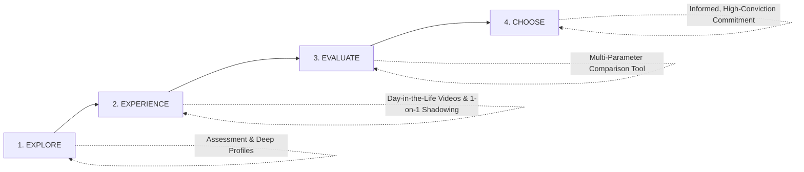
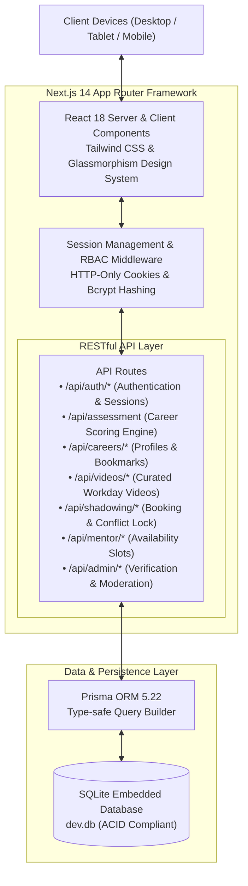
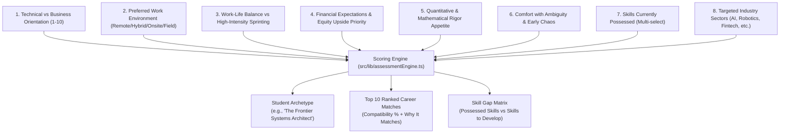
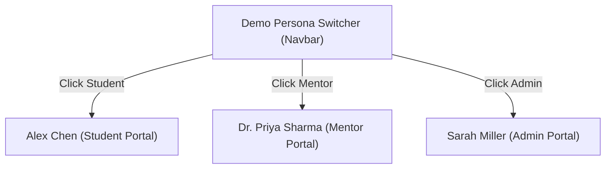
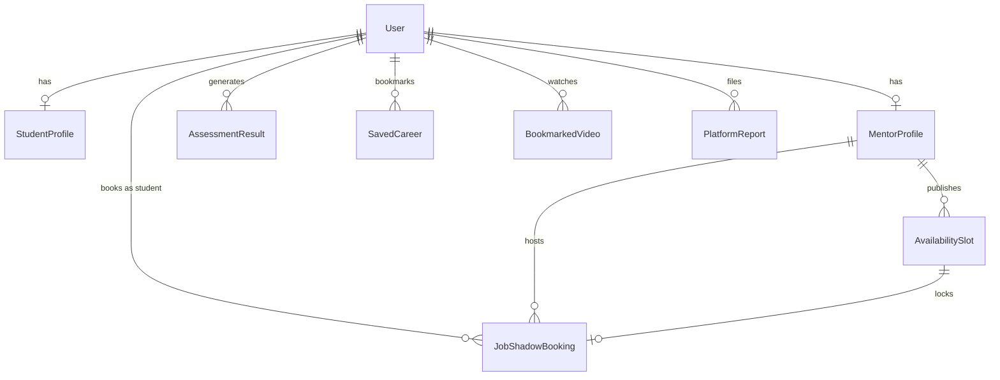

# 🚀 CareerFind — Career Discovery, Exploration & Job Shadowing Platform

[](https://nextjs.org/)
[](https://www.typescriptlang.org/)
[](https://tailwindcss.com/)
[](https://www.prisma.io/)
[](https://www.sqlite.org/)
[](https://opensource.org/licenses/MIT)

> ### *"Don't Just Choose a Career. Experience It Before You Commit."*
> **Core Product Philosophy: Explore. Experience. Evaluate. Choose.**

---

## 📖 Table of Contents

1. [Executive Summary](#-executive-summary)
2. [Product Philosophy & Problem Statement](#-product-philosophy--problem-statement)
3. [Technology Architecture & System Design](#-technology-architecture--system-design)
4. [UI/UX & Design System](#-uiux--design-system)
5. [Core Functional Modules](#-core-functional-modules)
   - [Module 1: Career Discovery & Assessment](#module-1-career-discovery--assessment)
   - [Module 2: Career Exploration Library (14-Section Deep Profiles)](#module-2-career-exploration-library-14-section-deep-profiles)
   - [Module 3: "A Day in the Life" – Curated Video Library](#module-3-a-day-in-the-life--curated-video-library)
   - [Module 4: Professional Networking & Job Shadowing Marketplace](#module-4-professional-networking--job-shadowing-marketplace)
   - [Module 5: Personalized Student Dashboard](#module-5-personalized-student-dashboard)
   - [Module 6: Multi-Parameter Career Comparison Tool](#module-6-multi-parameter-career-comparison-tool)
   - [Module 7: Administration & Verification Cockpit](#module-7-administration--verification-cockpit)
6. [User Personas & 1-Click Demo Switcher](#-user-personas--1-click-demo-switcher)
7. [Database Schema & Data Models](#-database-schema--data-models)
8. [API Route Specifications](#-api-route-specifications)
9. [Trust, Safety & In-Person Protocols](#-trust-safety--in-person-protocols)
10. [Local Development & Setup Guide](#-local-development--setup-guide)

---

## 🌟 Executive Summary

**CareerFind** is a modern, full-stack web application engineered to bridge the critical gap between **what students study in university lecture halls and what world-class professionals actually do in their careers every single day**.

Built as a responsive web application across desktop, tablet, and mobile, CareerFind provides:
- **An explainable career recommendation engine** based on personal aptitude, work style, mathematical preferences, pressure tolerance, and financial aspirations.
- **A 14-section exhaustive career encyclopedia** unpacking emerging and core disciplines (*e.g., Forward Deployed Engineering, Physical AI, LLM/AI Research, Product Management, Investment Banking, CleanTech*).
- **A curated documentary video ecosystem** integrating real YouTube embeds showing genuine working hours and engineering trade-offs.
- **A high-trust job shadowing marketplace** where verified industry practitioners host students for virtual or in-person observation sessions with automated conflict protection.
- **Interactive comparative visualizers** evaluating multiple career paths across 8 quantitative and qualitative dimensions simultaneously.

---

## 🎯 Product Philosophy & Problem Statement

### The Fundamental Problem
Higher education delivers theoretical coursework, but students often graduate without ever witnessing:
- What a **Forward Deployed Engineer (FDE)** actually troubleshoots when deployed on-site with emergency hospital logistics.
- The real differences between **Academic AI Research** and **Production ML Systems Engineering**.
- The physical and cognitive reality of **60–80 hour deal weeks** in Wall Street Investment Banking or Strategy Consulting.
- How **Product Managers** negotiate roadmap tradeoffs without direct authority over software teams.

### The CareerFind Solution: The 4-Stage Continuum


1. **EXPLORE:** Identify roles aligned with your natural strengths, work environment preferences, and learning curves.
2. **EXPERIENCE:** Watch unfiltered workday documentaries and shadow verified industry practitioners inside real corporate environments.
3. **EVALUATE:** Compare 2 to 4 professions side by side on compensation, work-life balance, and entry barriers.
4. **CHOOSE:** Make confident academic and career investments based on firsthand reality, not speculative guesswork.

---

## 🏗️ Technology Architecture & System Design

CareerFind is constructed with a modular, scalable, full-stack architecture prioritizing performance, type safety, and zero external infrastructure friction.



### Technical Stack Highlights
- **Framework:** [Next.js 14.2.15](https://nextjs.org/) (App Router architecture with React Server Components for SEO and fast pre-rendering, combined with dynamic Client Components for rich client interactivity).
- **Language:** [TypeScript 5.x](https://www.typescriptlang.org/) with strict type checking across all data models, API payloads, and UI props.
- **Styling:** [Tailwind CSS 3.4](https://tailwindcss.com/) with extended theme tokens, arbitrary values, and custom backdrop-blur utilities.
- **Database & ORM:** [Prisma ORM 5.22](https://www.prisma.io/) backed by **SQLite** (`dev.db`). This makes the repository completely self-contained, requiring zero external database daemon configuration (e.g., PostgreSQL or Docker) to test or run locally.
- **Visuals & Icons:** [Lucide React](https://lucide.dev/) (consistent, modern SVG icon library).
- **Security & Auth:** Secure password hashing using `bcryptjs` (salt rounds: 10), HTTP-only lax session cookies, and declarative Role-Based Access Control (RBAC).

---

## 🎨 UI/UX & Design System

The user interface follows a **modern, luxury dark SaaS aesthetic** engineered for focus, elegance, and visual delight.

### 1. Color Palette Tokens
| Token | Hex / HSL | Usage |
| :--- | :--- | :--- |
| **Dark Canvas** | `#0b0f19` to `#030712` | Background radial gradients for high-contrast readability. |
| **Brand Indigo** | `#6366f1` / `#4f46e5` | Primary action buttons, active navigation states, and hero glowing badges. |
| **Vibrant Purple**| `#a855f7` / `#c084fc` | Video library accents, documentary badges, and gradient text highlights. |
| **Emerald Host** | `#10b981` / `#059669` | Verified mentor badges, free-tier indicators, and booking confirmations. |
| **Amber Gold**   | `#f59e0b` / `#fbbf24` | Host star ratings, pending verification queues, and business category badges. |
| **Rose Alert**   | `#f43f5e` / `#fda4af` | Cancellation alerts, user report flags, and high-pressure career indicators. |

### 2. Design System Components
- **Glassmorphism Panels (`.glass-panel`):** Multi-layered backdrop blur (`backdrop-filter: blur(16px)`) with subtle borders (`rgba(255, 255, 255, 0.08)`) and inset light reflections.
- **Gradient Headings (`.gradient-text`):** Smooth typography transitions from slate white into indigo, violet, and soft pink.
- **Interactive Hover Lifts (`.glass-panel-hover`):** 3D perspective transforms (`translateY(-2px)`) with soft colored glow shadows.
- **Custom Ergonomic Scrollbars:** Sleek `#27273a` track with `#4338ca` hover response.
- **Mobile-Responsive Drawer:** Collapsible navigation sheet with touch-friendly tap targets and active route highlighting.

---

## ⚙️ Core Functional Modules

### MODULE 1: Career Discovery & Assessment
Located at [`/assessment`](http://localhost:3000/assessment)

An intelligent, multi-attribute career compatibility engine that evaluates students across 9 critical dimensions rather than simplistic binary questions:



#### Results Dashboard Highlights:
- **Archetype Classification:** Identifies cognitive styles such as *The Frontier Systems Architect*, *The High-Conviction Venture Founder*, *The High-Stakes Dealmaker*, or *The Human-Centered Product Innovator*.
- **Top 10 Ranked Careers:** Displays compatibility percentage (45% to 98%), explainability rationale ("Why this matches your profile"), salary progression preview, learning difficulty, and 1-click comparison buttons.
- **Explainable Recommendation Note:** Transparently states that scores reflect multi-attribute alignment rather than predictive certainty.

---

### MODULE 2: Career Exploration Library (14-Section Deep Profiles)
Located at [`/careers`](http://localhost:3000/careers) and [`/careers/[slug]`](http://localhost:3000/careers/forward-deployed-engineer)

A comprehensive encyclopedia of modern professions filterable by **Technology & Engineering**, **Business & Management**, and **Emerging & Other Careers**, backed by real-time keyword search, salary sliders, and work-life balance thresholds.

#### The 14 Required Profile Sections on Every Career Page:
1. **Overview & Key Metrics:** Scope of the role, industry classification, and quick stats ribbon.
2. **Daily Responsibilities Checklist:** Concrete tasks executed during a standard week.
3. **A Day in the Life Narrative:** An authentic, hour-by-hour timeline (*09:00 AM standup, 11:00 AM pipeline debugging, 02:00 PM architecture review*).
4. **Typical Work Environment:** Remote friendliness score (1–10), work pressure index, and field/office distribution.
5. **Required Education & Qualifications:** Degree requirements, alternative self-taught portfolios, and hiring bar difficulty.
6. **Essential Technical & Soft Skills:** Tagged skill pills distinguishing coding/math proficiency from cross-functional communication.
7. **Tools & Technologies Stack:** Real industry software stacks (*e.g., PyTorch, Triton, ROS2, Linear, Figma, Bloomberg Terminal*).
8. **Salary Progression Spectrum:** Visual breakdown across **Entry-Level (0–2 yrs)**, **Mid-Career (3–5 yrs)**, and **Senior / Principal (6–10+ yrs)** in USD thousands.
9. **Career Progression Roadmap:** Multi-stage promotion pathway from Associate to Executive Director/Partner.
10. **Job Market Demand & Future Outlook:** 10-year projected growth percentage and the direct impact of AI automation.
11. **Key Advantages & Disadvantages:** Objective, balanced pros and cons to eliminate romanticized illusions.
12. **Work-Life Balance & Pressure Analysis:** Weekly hour commitments and stress realities.
13. **International Career Opportunities:** Global hub mobility (*Silicon Valley, London, Zurich, Tokyo, Singapore*).
14. **Real Verified Professionals:** Current mentors practicing this profession with direct 1-click **"Book Job Shadow"** triggers.

---

### MODULE 3: "A Day in the Life" – Curated Video Library
Located at [`/videos`](http://localhost:3000/videos)

A dedicated documentary library integrating legitimate YouTube embeds that demonstrate real workday environments.

- **Legitimate YouTube Embeds:** High-performance, privacy-enhanced video modal (`youtube-nocookie.com`) with clean overlay theater mode.
- **Curated Career Playlists:** Pre-filtered streams for AI Engineers, Forward Deployed Engineers, Physical AI Robotics Leads, Product Managers, Consultants, and Wall Street Analysts.
- **Key Takeaways Checklist:** Every video displays curated bullet points summarizing what students should observe (*e.g., how research models translate to production clusters, client communication tactics*).
- **Personal Watchlist:** 1-click video bookmarking stored persistently in the database.
- **Community Submission Modal:** Students and professionals can suggest new videos for administrative curation.

---

### MODULE 4: Professional Networking & Job Shadowing Marketplace
Located at [`/shadowing`](http://localhost:3000/shadowing)

The platform's flagship feature connecting students with vetted industry practitioners for observational learning.

- **Verified Host Profiles:** Showcases company, job title, total years of experience, host rating, and verified credentials badge.
- **Flexible Formats:** Supports **Virtual Shadowing** (remote sprint observation, code reviews, screen-share architecture walk-throughs) and **In-Person Shadowing** (corporate office campus visits).
- **Real-Time Slot Scheduling:** Mentors publish specific date and time windows.
- **Double-Booking Conflict Prevention:** Database-level slot locking ensures no two students can book the same mentor slot (returns HTTP 409 Conflict if a collision occurs).
- **Automated Meeting Room Generation:** Virtual bookings automatically generate secure meeting links (`https://meet.google.com/cfs-[hash]-shadow`).
- **Student Introduction Requirement:** Students submit their background, questions, and goals before confirming.

---

### MODULE 5: Personalized Student Dashboard
Located at [`/student/dashboard`](http://localhost:3000/student/dashboard)

A centralized hub tracking the student's career preparation journey:

- **Exploration Progress Meter:** Dynamic progress score (0–100%) tracking assessment completion, saved profiles, video watchlists, and attended sessions.
- **Assessment Results Card:** Current archetype and top recommended careers.
- **Active Shadowing Sessions:** Scheduled sessions with host avatars, session formats, and direct meeting join links.
- **Session History & Review Notes:** Access constructive feedback provided by mentors after completed sessions.
- **Saved Careers & Watchlist:** Direct access to bookmarked careers and videos ([`/student/saved`](http://localhost:3000/student/saved)).

---

### MODULE 6: Multi-Parameter Career Comparison Tool
Located at [`/student/compare`](http://localhost:3000/student/compare)

Allows students to compare **2 to 4 professions simultaneously** across both quantitative metrics and qualitative lifestyle parameters.

#### Quantitative Dimension Comparison (Scale 1–10)
- Technical Complexity
- Mathematical Requirements
- Learning Curve Difficulty
- First Job Hiring Barrier
- Work Pressure
- Work-Life Balance
- Remote Flexibility
- Future Demand Score

#### Qualitative Matrix
- Typical Work Modes (Remote vs. Lab vs. Client Travel)
- Required Degrees and Accreditations
- 10-Year Industry Growth Outlook
- International Career Mobility

---

### MODULE 7: Administration & Verification Cockpit
Located at [`/admin/dashboard`](http://localhost:3000/admin/dashboard)

An oversight interface empowering platform administrators to maintain trust, quality, and safety:

- **Executive KPI Dashboard:** Real-time metrics on Total Users, Verified Mentors, Active Bookings, and Host Acceptance Rates.
- **Mentor Verification Queue:** Review pending host applications, audit corporate domain emails and licenses, and **Approve** or **Reject** with feedback notes.
- **Platform Booking Monitor:** Live log of all scheduled shadowing sessions with status tracking.
- **Safety Reports & Moderation:** Resolve user reports regarding host conduct, attendance, or video quality.

---

## 👥 User Personas & 1-Click Demo Switcher

CareerFind features an interactive **Role Switcher** in the navigation header. Clicking any persona instantly switches the active session cookie and redirects you to the corresponding portal.



### Pre-Seeded Evaluation Accounts
| Role | Name | Title / Organization | Email | Password |
| :--- | :--- | :--- | :--- | :--- |
| 🎓 **Student** | **Alex Chen** | Junior CS & CogSci @ UC Berkeley | `alex.chen@university.edu` | `password123` |
| 💼 **Mentor** | **Dr. Priya Sharma** | Staff AI Engineer @ Google DeepMind | `priya.sharma@deepmind.com` | `password123` |
| 💼 **Mentor (FDE)** | **Marcus Vance** | Lead Forward Deployed Engineer @ Palantir | `marcus.vance@palantir.com` | `password123` |
| 💼 **Mentor (PM)** | **Elena Rostova** | VP of Product @ Stripe | `elena.rostova@stripe.com` | `password123` |
| 💼 **Mentor (Robotics)**| **David Kim** | Principal Physical AI Lead @ Boston Dynamics | `david.kim@bostondynamics.com` | `password123` |
| 🛡️ **Admin** | **Sarah Miller** | Platform Director & Head of Trust | `admin@careerfind.com` | `password123` |

---

## 🗄️ Database Schema & Data Models

The persistence layer is defined in [`prisma/schema.prisma`](file:///c:/Users/abhi%20vivobook/Desktop/CarrerFind/prisma/schema.prisma) and executed against an embedded SQLite database.



### Core Entity Definitions:
- **`User`**: Base identity storing email, hashed password, role (`STUDENT`, `MENTOR`, `ADMIN`), name, avatar URL, and headline.
- **`StudentProfile`**: Academic level, major, graduation year, existing skills array, and preferred work modes.
- **`MentorProfile`**: Company, designation, industry, experience years, verification status (`PENDING`, `APPROVED`, `REJECTED`), daily narrative, session duration, and ratings.
- **`AvailabilitySlot`**: Mentor ID, date (`YYYY-MM-DD`), start/end times, mode (`VIRTUAL` / `IN_PERSON`), and boolean `isBooked` flag.
- **`Career`**: 14 profile dimensions including salary spectrums, difficulty meters, roadmap stages, pros/cons, and industry classification.
- **`Video`**: YouTube ID, creator, duration, profession slug, seniority level, description, and key takeaways.
- **`JobShadowBooking`**: Student ID, Mentor ID, Slot ID, session date/time, mode, meeting URL, student introduction, and status (`PENDING`, `APPROVED`, `REJECTED`, `COMPLETED`, `CANCELLED`).
- **`AssessmentResult`**: Snapshot of user answers, calculated archetype, and recommended career ranking.
- **`PlatformReport`**: Target entity, reporter ID, complaint reason, and resolution status.

---

## 📡 API Route Specifications

| Method | Endpoint | Description | Role Access |
| :--- | :--- | :--- | :--- |
| `GET` | `/api/auth/me` | Fetch currently authenticated user session | Public / Any |
| `POST` | `/api/auth/login` | Authenticate with email and password | Public |
| `POST` | `/api/auth/register` | Register new student or mentor account | Public |
| `POST` | `/api/auth/logout` | Clear session cookie | Authenticated |
| `POST` | `/api/auth/demo-switch` | Instant 1-click persona switch | Demo / Any |
| `POST` | `/api/assessment` | Score questionnaire and return top 10 recommendations | Public / Student |
| `GET` | `/api/careers` | Filter and search career profiles | Public |
| `POST` | `/api/careers/save` | Toggle career bookmark | Student |
| `GET` | `/api/videos` | Query video library with category and role filters | Public |
| `POST` | `/api/videos` | Submit a community video suggestion | Authenticated |
| `POST` | `/api/videos/bookmark` | Toggle video watchlist bookmark | Student |
| `GET` | `/api/shadowing/professionals` | Query verified mentors and available slots | Public |
| `POST` | `/api/shadowing/book` | Book job shadow slot (with conflict prevention) | Student |
| `GET` | `/api/mentor/bookings` | View incoming and scheduled sessions | Mentor |
| `PATCH`| `/api/mentor/bookings` | Approve, reject, or provide feedback on sessions | Mentor |
| `GET` | `/api/mentor/slots` | Fetch mentor's published time slots | Mentor |
| `POST` | `/api/mentor/slots` | Publish a new virtual or in-person time slot | Mentor |
| `DELETE`| `/api/mentor/slots` | Remove an unbooked time slot | Mentor |
| `GET` | `/api/student/dashboard` | Aggregate student metrics, bookings, and recommendations | Student |
| `GET` | `/api/admin/overview` | Fetch platform KPIs, verification queue, and reports | Admin |
| `POST` | `/api/admin/verify-mentor`| Approve or reject mentor credentials | Admin |
| `PATCH`| `/api/admin/reports` | Resolve or dismiss platform moderation reports | Admin |

---

## 🛡️ Trust, Safety & In-Person Protocols

To ensure safety and confidentiality during **in-person job shadowing**:
1. **Professional Identity Verification:** Mentors must verify their corporate domain email or professional license before their profile is displayed publicly.
2. **Approved Physical Locations Only:** In-person shadowing takes place exclusively inside registered corporate offices, university laboratories, or verified co-working spaces with visitor badge registration.
3. **Confidentiality & Non-Disclosure (NDA):** Students agree to an ethical code of conduct committing to protect proprietary company code, client data, and internal meetings.
4. **Zero-Tolerance Reporting:** Students and mentors have access to a direct reporting channel moderated by Platform Administrators with a 24-hour turnaround SLA.

---

## 💻 Local Development & Setup Guide

### Prerequisites
- [Node.js](https://nodejs.org/) v18.17+ or v20.x or v22.x
- `npm` v9+ or `pnpm` or `yarn`

### Step 1: Clone Repository
```bash
git clone https://github.com/AbhinavPandey12/CarrerFind---Best-Carrer-for-You.git
cd CarrerFind---Best-Carrer-for-You
```

### Step 2: Install Dependencies
```bash
npm install
```

### Step 3: Initialize Database & Seed Realistic Data
```bash
# Push database schema to generate local SQLite dev.db
npx prisma db push

# Run the comprehensive seed script (Careers, Mentors, Slots, Videos, Bookings)
node prisma/seed.js
```

### Step 4: Run Development Server
```bash
npm run dev
```

Open [http://localhost:3000](http://localhost:3000) in your browser.

### Step 5: Build for Production (Optional)
```bash
npm run build
npm run start
```

---

## 📄 License

This project is licensed under the [MIT License](LICENSE).
