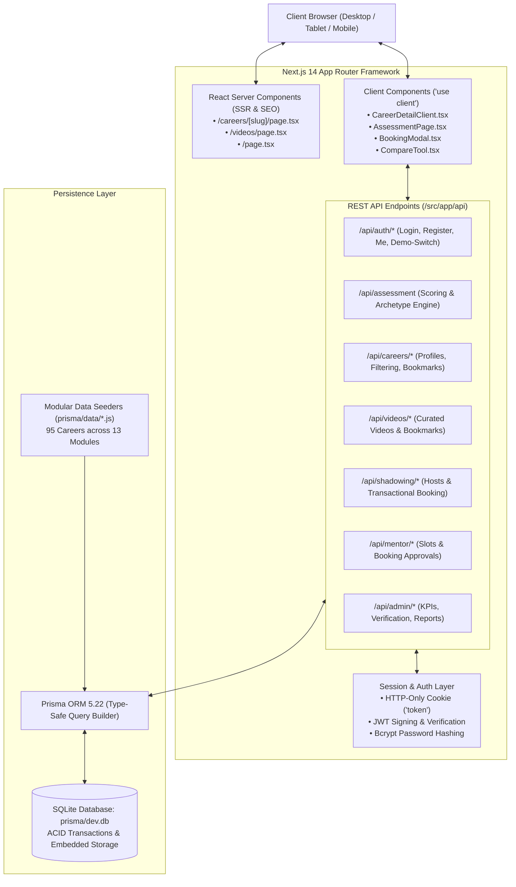
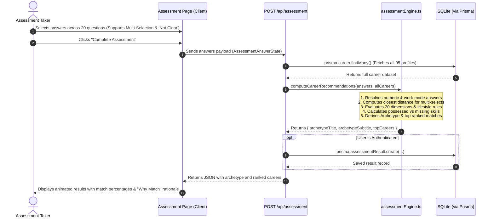
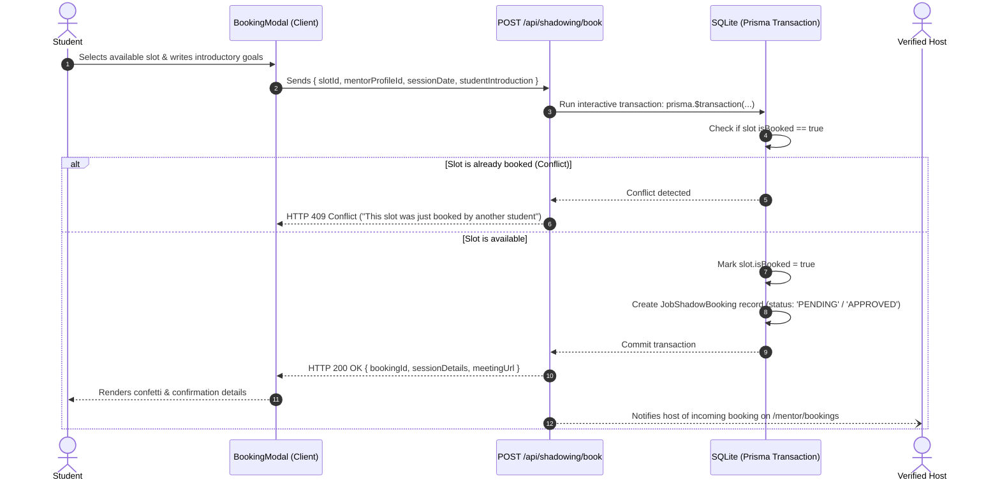
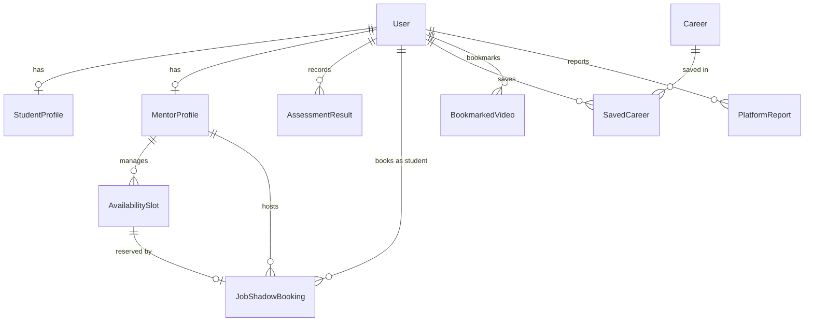

# 🚀 CareerFind — Comprehensive Career Discovery, Exploration & Job Shadowing Platform

[](https://nextjs.org/)
[](https://www.typescriptlang.org/)
[](https://tailwindcss.com/)
[](https://www.prisma.io/)
[](https://www.sqlite.org/)
[](https://opensource.org/licenses/MIT)

> ### *"Don't Just Choose a Career. Experience It Before You Commit."*
> **Core Product Continuum: Explore $\rightarrow$ Experience $\rightarrow$ Evaluate $\rightarrow$ Choose.**

---

## 📖 Table of Contents

1. [Executive Summary](#-executive-summary)
2. [End-to-End System Architecture & Data Flow](#-end-to-end-system-architecture--data-flow)
3. [Environment Variables & Dependencies](#-environment-variables--dependencies)
4. [Database Configuration & Profile Management](#-database-configuration--profile-management)
   - [Database Setup & Prisma ORM](#database-setup--prisma-orm)
   - [Entity-Relationship Diagram](#entity-relationship-diagram)
   - [User Profile Storage & Retrieval](#user-profile-storage--retrieval)
   - [Job Profile Storage, Retrieval & Management (Adding New Careers)](#job-profile-storage-retrieval--management-adding-new-careers)
5. [Assessment Engine & Recommendation Algorithm Workflow](#-assessment-engine--recommendation-algorithm-workflow)
   - [The 20 Assessment Dimensions](#the-20-assessment-dimensions)
   - [Multi-Selection Scoring Mathematics](#multi-selection-scoring-mathematics)
   - [Handling 'Not Clear' Fallbacks](#handling-not-clear-fallbacks)
   - [Lifestyle Avoidance & Non-Negotiable Rules](#lifestyle-avoidance--non-negotiable-rules)
   - [Archetype Classification & Dynamic Matching](#archetype-classification--dynamic-matching)
   - [Assessment Submission & Persistence Flow](#assessment-submission--persistence-flow)
6. [Core Application Modules](#-core-application-modules)
   - [Module 1: Interactive Career Assessment](#module-1-interactive-career-assessment)
   - [Module 2: 95-Career Encyclopedia & 5-Tab Profile Experience](#module-2-95-career-encyclopedia--5-tab-profile-experience)
   - [Module 3: "A Day in the Life" Workday Documentary Library](#module-3-a-day-in-the-life-workday-documentary-library)
   - [Module 4: Job Shadowing Marketplace & Conflict-Free Booking](#module-4-job-shadowing-marketplace--conflict-free-booking)
   - [Module 5: Student Hub & Progress Dashboard](#module-5-student-hub--progress-dashboard)
   - [Module 6: Multi-Career Comparative Evaluation Tool](#module-6-multi-career-comparative-evaluation-tool)
   - [Module 7: Administration & Verification Cockpit](#module-7-administration--verification-cockpit)
7. [Verified API Route Specifications](#-verified-api-route-specifications)
8. [Trust, Safety & In-Person Protocols](#-trust-safety--in-person-protocols)
9. [Pre-Configured Demo Personas](#-pre-configured-demo-personas)
10. [Complete Step-by-Step Local Setup & Execution Guide](#-complete-step-by-step-local-setup--execution-guide)
11. [Observability, Telemetry & Structured Logging](#-observability-telemetry--structured-logging)

---

## 🌟 Executive Summary

**CareerFind** is a production-grade, full-stack career discovery and experiential shadowing platform designed to eliminate the costly guesswork from education and career decision-making. 

Instead of forcing students and professionals to rely on idealized job descriptions, CareerFind combines:
- **An Explainable 20-Question Multi-Select Assessment Engine** that maps personal cognitive strengths, quantitative comfort, work modes, and non-negotiables to compatibility ratings across all careers.
- **An Exhaustive 95-Profession Career Encyclopedia** spanning 13 industry domains (*Technology & AI, Business & Brand Management, Creative Arts & Cinema, Fashion & Modeling, Athletics & Sports Coaching, Law & Judiciary, Indian Sovereign Government & Civil Services, Railways & PSUs, Medicine, and Engineering*).
- **A 5-Tab Interactive Profile Experience** on every career page featuring **Overview**, **A Day in the Life** (hour-by-hour chronological schedule, workload split, and documentary videos), **Job Shadowing** (4 learning pillars, verified hosts, and 1-click booking), **Skills & Roadmap**, and **Compensation & Growth**.
- **A High-Trust Job Shadowing Marketplace** facilitating virtual and on-site observation sessions with verified industry practitioners, protected by database-level double-booking prevention.
- **Side-by-Side Multi-Parameter Career Comparison** evaluating up to 4 roles across 8 quantitative and qualitative dimensions simultaneously.

---

## 🏗️ End-to-End System Architecture & Data Flow

CareerFind is engineered with a modern, monolithic Next.js App Router architecture that balances server-side rendering performance with rich client-side interactivity.

### High-Level System Architecture



### Assessment Submission & Recommendation Flow



### Job Shadowing Booking & Conflict-Locking Flow



---

## 🔐 Environment Variables & Dependencies

### Environment Variables Configuration

The project operates out of the box with zero required external third-party services. The configuration is loaded via environment variables with safe internal defaults:

| Variable | Required | Default Value | Description |
| :--- | :--- | :--- | :--- |
| `DATABASE_URL` | Optional | `"file:./dev.db"` | SQLite connection string used by Prisma. Set to `file:./dev.db` located inside `prisma/`. |
| `JWT_SECRET` | Optional | `careerfind-super-secret-jwt-key-production` | Secret cryptographic key used to sign and verify JSON Web Tokens in HTTP-only session cookies. |
| `PORT` | Optional | `3000` | Local HTTP port for the Next.js server. |
| `NODE_ENV` | Optional | `development` | Runtime environment (`development`, `production`, or `test`). |

To customize these, create a `.env` file in the root directory:

```env
DATABASE_URL="file:./dev.db"
JWT_SECRET="your-custom-secure-jwt-secret-here"
PORT=3000
NODE_ENV=development
```

### Dependencies Breakdown

All packages are strictly pinned in [`package.json`](file:///c:/Users/abhi%20vivobook/Desktop/CarrerFind/package.json):

#### Production Dependencies
- **`next` (`14.2.15`)**: Core React framework utilizing App Router, Server Components, and API routes.
- **`react` & `react-dom` (`^18.x`)**: Core UI component library.
- **`@prisma/client` (`^5.22.0`)**: Auto-generated type-safe database client.
- **`bcryptjs` (`^2.4.3`)**: Password salt generation and hash verification.
- **`jsonwebtoken` (`^9.0.2`)**: JWT token creation, encoding, and cookie verification.
- **`lucide-react` (`^0.454.0`)**: Modern SVG iconography.
- **`clsx` & `tailwind-merge` (`^2.x`)**: Dynamic CSS class composition.
- **`canvas-confetti` (`^1.9.4`)**: Visual celebratory feedback on assessment completion and shadowing bookings.

#### Development Dependencies
- **`prisma` (`^5.22.0`)**: Prisma CLI for database migrations, schema pushing, and studio inspector.
- **`typescript` (`^5.x`)**: Strict compile-time static type analysis.
- **`tailwindcss` (`^3.4.x`)** & **`postcss`**: Utility-first CSS styling engine.
- **`@types/*`**: Comprehensive TypeScript definitions for Node, React, Bcrypt, and JWT.

---

## 🗄️ Database Configuration & Profile Management

### Database Setup & Prisma ORM

The application uses an embedded **SQLite** database (`prisma/dev.db`). This makes CareerFind completely self-contained with zero Docker or external database service requirements.

Key Prisma commands:
```bash
# Push schema changes to the local SQLite database without creating heavy SQL migration files
npx prisma db push

# Re-generate the TypeScript Prisma Client after schema changes
npx prisma generate

# Launch Prisma Studio to visually inspect and edit records in your browser
npx prisma studio
```

### Entity-Relationship Diagram



### User Profile Storage & Retrieval

1. **User Registration (`POST /api/auth/register`):**
   - Receives `name`, `email`, `password`, and `role` (`STUDENT` or `MENTOR`).
   - Hashes password using `bcrypt.hash(password, 10)`.
   - Creates the parent `User` record.
   - If `role === 'STUDENT'`, creates a linked `StudentProfile` storing `academicLevel`, `majorOrField`, `skillsPossessed`, and `preferredWorkMode`.
   - If `role === 'MENTOR'`, creates a linked `MentorProfile` with `company`, `title`, `industry`, `experienceYears`, starting with `verificationStatus: 'PENDING'`.

2. **Session Authentication & Profile Retrieval:**
   - On successful login, signs a JWT containing `{ id, email, role }` with a 7-day expiration and sets it as an `HTTP-Only`, `SameSite=Lax` cookie named `token`.
   - The helper `getCurrentUser()` in [`src/lib/auth.ts`](file:///c:/Users/abhi%20vivobook/Desktop/CarrerFind/src/lib/auth.ts) decodes the cookie and retrieves the full profile:
     ```ts
     const user = await prisma.user.findUnique({
       where: { id: decoded.id },
       include: { studentProfile: true, mentorProfile: true },
     });
     ```
   - Allows clean Role-Based Access Control (RBAC) across student, mentor, and administrative routes.

---

### Job Profile Storage, Retrieval & Management (Adding New Careers)

All **95 career profiles** in CareerFind are stored in the `Career` table and defined across modular JavaScript data files in [`prisma/data/`](file:///c:/Users/abhi%20vivobook/Desktop/CarrerFind/prisma/data/):

| Data Module File | Domain Coverage | Career Count |
| :--- | :--- | :--- |
| `techCareers.js` | Core AI, Systems, Software & Cloud Engineering | 8 careers |
| `newTechCareers.js` | Generative AI, Quantum Computing, Climate Tech, Physical AI | 10 careers |
| `specialistCareers.js` | Fintech, Big Data, GTM Engineering, AI Product Management | 8 careers |
| `coreSplitCareers.js` | Full Stack, Frontend, Backend, ML, Data Specialists | 8 careers |
| `businessCareers.js` | Product Management, Strategy Consulting, Venture Capital | 8 careers |
| `financeCareers.js` | Investment Banking, Quantitative Trading, Private Equity | 7 careers |
| `healthCareers.js` | Cardiology, Neurobiology, Clinical Psychology, Biotech | 8 careers |
| `lawGovCareers.js` | Civil Services (IAS/IPS), Armed Forces, High Court Law, Diplomat | 6 careers |
| `builtCareers.js` | Civil, Architecture, Mechanical & Renewable Power Systems | 7 careers |
| `creativeCareers.js` | Film Direction, 3D Animation, Game Design, UX Architecture | 8 careers |
| `aviationMaritimeCareers.js` | Airline Captains, Aerospace Engineering, Maritime Logistics | 5 careers |
| `eduHospitalitySportsCareers.js` | Executive Gastronomy, Sports Science & Coaching | 3 careers |
| `newExtensionCareers.js` | Brand Manager, Athlete, Model, Actor, PSU Executive, Railways | 6 careers |
| **Total** | **All 13 Sectors Combined** | **95 Careers** |

#### Schema Definition of a Career Profile
Each career conforms to the `Career` model in `prisma/schema.prisma` across 26 rich fields:
```prisma
model Career {
  id                          String   @id @default(cuid())
  slug                        String   @unique
  title                       String
  category                    String   // e.g. "Technology & Engineering", "Law & Government"
  industry                    String
  shortDescription            String
  overview                    String
  dailyResponsibilities       String   // JSON string array
  dayInLife                   String   // Formatted chronological workday schedule
  typicalWorkEnvironment      String   // Remote, Hybrid, Office, Lab, Field
  requiredEducation           String
  essentialTechSkills         String   // JSON string array
  essentialSoftSkills         String   // JSON string array
  toolsAndTechnologies        String   // JSON string array
  entrySalaryMin              Int      // USD in thousands (e.g. 85 = $85,000)
  entrySalaryMax              Int
  midSalaryMin                Int
  midSalaryMax                Int
  seniorSalaryMin             Int
  seniorSalaryMax             Int
  learningDifficulty          Int      // 1-10 scale
  entryJobDifficulty          Int      // 1-10 scale
  technicalComplexity         Int      // 1-10 scale
  mathRequirements            Int      // 1-10 scale
  workPressure                Int      // 1-10 scale
  workLifeBalance             Int      // 1-10 scale
  remoteOpportunities         Int      // 1-10 scale
  careerStability             Int      // 1-10 scale
  futureDemandScore           Int      // 1-10 scale
  futureDemandOutlook         String   // e.g. "26% projected 10-year growth"
  growthPotential             Int      // 1-10 scale
  internationalOpportunities  String
  advantages                  String   // JSON string array
  disadvantages               String   // JSON string array
  careerProgressionRoadmap    String   // JSON string array of stages
  iconName                    String   @default("Briefcase")
  featured                    Boolean  @default(false)
  createdAt                   DateTime @default(now())
}
```

#### How to Add a New Career Profile to the Backend

To add a new career profile, follow these simple steps:

1. **Add the Career Definition:**
   Open the relevant file in `prisma/data/` (or create a new module and export it in `prisma/data/index.js`). Define the profile with its unique slug and all 26 fields:
   ```javascript
   {
     slug: "renewable-energy-director",
     title: "Renewable Energy Director",
     category: "Engineering & Built Environment",
     industry: "CleanTech & Energy",
     shortDescription: "Directing utility-scale solar, wind, and battery energy transition programs.",
     overview: "Full overview text...",
     dailyResponsibilities: JSON.stringify(["Grid interconnection modeling", "Turbine procurement", "EPC audits"]),
     dayInLife: "08:30 AM - Grid telemetry audit\n10:30 AM - EPC contractor standup\n02:00 PM - Environmental regulatory hearing\n05:30 PM - Capital allocation debrief",
     typicalWorkEnvironment: "Hybrid (Site visits + Remote design)",
     requiredEducation: "B.Tech in Electrical/Mechanical Engineering + PE License",
     essentialTechSkills: JSON.stringify(["PSCAD", "Power Systems", "Grid Interconnection"]),
     essentialSoftSkills: JSON.stringify(["Stakeholder Negotiation", "Risk Mitigation"]),
     toolsAndTechnologies: JSON.stringify(["ETAP", "MATLAB", "AutoCAD Electrical"]),
     entrySalaryMin: 80,
     entrySalaryMax: 110,
     midSalaryMin: 130,
     midSalaryMax: 180,
     seniorSalaryMin: 200,
     seniorSalaryMax: 290,
     learningDifficulty: 8,
     entryJobDifficulty: 7,
     technicalComplexity: 8,
     mathRequirements: 8,
     workPressure: 7,
     workLifeBalance: 7,
     remoteOpportunities: 6,
     careerStability: 9,
     futureDemandScore: 9,
     futureDemandOutlook: "32% projected 10-year growth (Much faster than average)",
     growthPotential: 9,
     internationalOpportunities: "High global demand across the US, EU, and India.",
     advantages: JSON.stringify(["High mission fulfillment", "Government-backed incentives"]),
     disadvantages: JSON.stringify(["Protracted regulatory review cycles"]),
     careerProgressionRoadmap: JSON.stringify(["Junior Project Engineer", "Lead Systems Engineer", "Engineering Director"]),
     iconName: "Zap",
     featured: true,
   }
   ```

2. **Sync the Database:**
   Run the seed script or execute an upsert query:
   ```bash
   node prisma/seed.js
   ```
   *Alternatively, in production without wiping other tables, use a script with `prisma.career.upsert({ where: { slug: ... }, update: ..., create: ... })`.*

3. **Instant Platform Integration:**
   Once saved in SQLite:
   - It is immediately accessible at `/careers/[slug]` with all 5 interactive tabs.
   - It is dynamically matched in `/assessment` scoring.
   - It can be filtered, searched, and compared in `/student/compare`.
   - Mentors and documentary videos are automatically matched using intelligent category fallbacks.

---

## 🧠 Assessment Engine & Recommendation Algorithm Workflow

The Assessment Engine located at [`src/lib/assessmentEngine.ts`](file:///c:/Users/abhi%20vivobook/Desktop/CarrerFind/src/lib/assessmentEngine.ts) powers the personalized recommendation experience.

### The 20 Assessment Dimensions

Every question has been rewritten in clear, everyday language with no confusing jargon:

1. **Technical & Engineering Orientation (Q1):** Software & AI vs. Physical Engineering vs. Tech Management vs. People/Creative Arts.
2. **Workplace Environment (Q2):** Fully Remote vs. Hybrid vs. Corporate Office vs. Active Field.
3. **Medium of Creation (Q3):** Digital Software vs. Physical Builds vs. Creative Arts & Media vs. Public Governance.
4. **Financial Trajectory (Q4):** High-Risk Equity Upside vs. Corporate Salary & Bonuses vs. Government Stability & Pension vs. Low-Stress Living Wage.
5. **Quantitative & Analytical Rigor (Q5):** Advanced Math/Algorithms vs. Business Metrics/Spreadsheets vs. Practical Everyday Logic vs. Little/No Math.
6. **Structure vs. Ambiguity (Q6):** Inventing from Scratch vs. Clear Goals with Freedom vs. Structured Standards vs. Strict Safety SOPs.
7. **Leadership & Influence Scope (Q7):** Executive Command vs. Creative Direction vs. Mentorship & Coaching vs. Solo Craft Mastery.
8. **Human Care & Social Welfare (Q8):** Direct Clinical Medicine vs. Teaching & Counseling vs. Community Public Service vs. Commercial Tech.
9. **Creative Expression & Storytelling (Q9):** Screen Acting & Modeling vs. Brand Strategy vs. Practical UX Design vs. Structured Facts & Law.
10. **Physical Mastery & Tactical Presence (Q10):** Athletics & On-Camera Poise vs. Hands-On Industrial Craft vs. Active Daily Movement vs. Desk-Bound Computer Work.
11. **Sovereign Service & Public Sector (Q11):** Civil Services (IAS/IPS) & Defence vs. PSUs & Railways vs. Judicial Courts vs. Private Companies.
12. **Lifelong Learning & Tech Velocity (Q12):** Fast-Paced Rapid Changes vs. Periodic Updates vs. Stable Foundational Principles vs. Intuitive Human Craft.
13. **Feedback Cadence & Horizon (Q13):** Immediate Daily Feedback vs. Monthly Sprints vs. Annual Milestones vs. Multi-Year Long-Term Infrastructure.
14. **Public Visibility & Spotlight (Q14):** On-Camera Public Spotlight vs. Brand Spokesperson vs. Professional Peer Respect vs. Behind-the-Scenes Privacy.
15. **Pressure Dynamics & Crisis Cadence (Q15):** High-Stakes Live Pressure vs. Deadline-Driven Milestones vs. Organized Predictable Schedules vs. Calm Low-Stress Routine.
16. **Lifestyle Avoidance Filter (Q16, Multi-Select):** Filters out dealbreaker conditions (*e.g., long commutes, sitting all day, micromanagement, 60+ hour burnout*).
17. **Current Skillset (Q17, Multi-Select):** 22 practical skills spanning coding, marketing, acting, athletics, law, budgeting, and mechanics.
18. **Target Industry Sectors (Q18, Multi-Select):** 13 industry domains to boost relevant career matches.
19. **Core Professional Purpose (Q19):** Public Service & Nation Building vs. Commercial Success vs. Artistic Impact vs. Scientific/Patient Care.
20. **Life Non-Negotiables & Dealbreakers (Q20, Multi-Select):** Daily Fitness & Health, Scheduled Hours, High Wealth, Family Time, Remote Flexibility, Job Security, Low Stress, etc.

---

### Multi-Selection Scoring Mathematics

Unlike rigid single-choice quizzes, CareerFind's recommendation engine natively supports **multiple selections** on all questions.

When a user selects multiple values for a dimension (e.g., both *Software & AI Development* [value: 9] and *Physical & Civil Engineering* [value: 7]), the scoring engine uses **minimum-distance similarity**:

$$\text{Similarity}(D, T) = \max\left(0, 1 - \frac{\min_{v \in D} |v - T|}{9}\right)$$

Where:
- $D$ is the set of user-selected values for that dimension.
- $T$ is the career profile's target value (on a 1–10 scale).
- $9$ is the maximum possible difference between two scale values.

This mathematical property ensures that selecting multiple interests **fairly rewards** any career that aligns closely with *any* of the user's chosen paths, instead of diluting their score with an artificial average.

### Handling 'Not Clear' Fallbacks

Every single-choice question includes an explicit **"Not Sure / Open to Exploration"** option. When selected:
- `isNotClear` is set to `true`.
- The engine assigns a neutral non-penalizing score ($0.75$, or 75% alignment) for that dimension.
- Undecided students are never penalized for exploring their options.

### Lifestyle Avoidance & Non-Negotiable Rules

The engine applies intelligent positive and negative adjustments based on the user's lifestyle inputs:

1. **Avoidance Penalties:**
   - Selecting *Sitting at a desk all day* applies a penalty to desk-bound software and finance roles while boosting field, athletic, and healthcare careers.
   - Selecting *Extreme stress and very long hours* penalizes careers with `workPressure >= 8` (e.g., Investment Banking, Trauma Surgery).
   - Selecting *Unstable income or layoffs* prioritizes Indian Civil Services, Railways, PSUs, and Healthcare.

2. **Non-Negotiables Boosts:**
   - Selecting *Daily Fitness & Health* prioritizes careers with healthy work-life balance scores or athletic components.
   - Selecting *Scheduled & Predictable Hours* rewards roles with low emergency volatility.
   - Selecting *Remote Work Flexibility* prioritizes careers with high `remoteOpportunities` scores.
   - Selecting *Job Security & Income Stability* elevates sovereign public sector and institutional careers.

3. **Possessed vs. Missing Skill Gap Analysis:**
   - Compares user's selected skills in Q17 against the career's `essentialTechSkills` and `toolsAndTechnologies`.
   - Divides skills into `possessedSkills` (immediate natural advantages) and `missingSkills` (skills to develop), empowering students to craft focused learning roadmaps.

### Archetype Classification & Dynamic Matching

Users are classified into one of 10 overarching archetype personas:
- **The Frontier Systems Architect:** High technical orientation, deep logic, scalable digital infrastructure.
- **The Sovereign Public Administrator:** Government leadership, civil governance, national infrastructure, public welfare.
- **The Creative Brand Visionary:** Brand strategy, visual storytelling, consumer advertising, design direction.
- **The Elite Tactical Athlete & Performer:** Athletic competition, sports coaching, high-fashion modeling, screen acting.
- **The Clinical Healer & Human Care Advocate:** Medicine, surgery, counseling, life-saving patient care.
- **The High-Conviction Venture Founder:** Extreme ambiguity tolerance, commercial ambition, exponential upside.
- **The Quantitative Capital Allocator:** Advanced mathematics, financial trading, corporate investment.
- **The Physical & Industrial Builder:** Civil engineering, robotics, plant operations, clean energy.
- **The Constitutional & Legal Advocate:** Law courts, judicial policy, compliance, regulatory counsel.
- **The Independent Maker & Specialist:** Solo craft, autonomy, deep specialization.

---

## 📱 Core Application Modules

### MODULE 1: Interactive Career Assessment
*Route: [`/assessment`](http://localhost:3000/assessment)*
- Step-by-step 20-question questionnaire wizard with real-time progress indicators.
- **Prominent Multi-Selection Notice** on every question card confirming that multiple options are supported and factored into compatibility calculations.
- Instant submission to `POST /api/assessment` returning ranked careers, compatibility percentages, archetype badges, and custom `whyMatch` rationales.

### MODULE 2: 95-Career Encyclopedia & 5-Tab Profile Experience
*Routes: [`/careers`](http://localhost:3000/careers) and [`/careers/[slug]`](http://localhost:3000/careers/brand-manager)*
- Filterable directory by 13 industry domains, salary sliders, remote flexibility, and keyword search.
- **5-Tab Navigation System** on every single profile:
  1. **Overview:** Executive summary, key metrics ribbon, educational qualifications, advantages & disadvantages.
  2. **A Day in the Life:** Interactive hour-by-hour chronological schedule, daily execution time-allocation breakdown (Execution, Collaboration, Triage, Strategy), work pressure badge, and relevant Day-in-the-Life video documentaries.
  3. **Job Shadowing:** 4 core learning pillars (Live Observation, Tool & Workflow Inspection, Unfiltered Q&A Reality Check, Resume & Portfolio Audit), 3-step workflow, verified practitioner cards with 1-click booking, custom host requests, and non-disclosure safety protocols.
  4. **Skills & Roadmap:** Core technical skills, soft skills, tools stack, and multi-stage career progression roadmap.
  5. **Compensation & Growth:** Entry, mid, and senior salary progression charts, 10-year projected demand growth, and international opportunities.

### MODULE 3: "A Day in the Life" Workday Documentary Library
*Route: [`/videos`](http://localhost:3000/videos)*
- Curated library of 25 authentic video documentaries powered by privacy-enhanced YouTube embeds (`youtube-nocookie.com`).
- Features duration tags, seniority levels, location badges, and structured key takeaways checklist.
- Filterable by career category and search keywords, with 1-click personal watchlist bookmarking.

### MODULE 4: Job Shadowing Marketplace & Conflict-Free Booking
*Route: [`/shadowing`](http://localhost:3000/shadowing)*
- Connects students with 12 verified industry practitioners across tech, clean energy, culinary arts, brand management, screen acting, athletics, and Indian Railways/government.
- Real-time availability slot selection for **Virtual** and **In-Person** sessions.
- Interactive modal booking form requiring students to submit learning goals and background.
- Protected by Prisma database transactions with slot collision detection to guarantee zero double-bookings.

### MODULE 5: Student Hub & Progress Dashboard
*Route: [`/student/dashboard`](http://localhost:3000/student/dashboard)*
- Centralized tracking interface for students.
- Displays exploration progress percentage, latest assessment archetype, upcoming and completed shadowing sessions, and bookmarked careers and videos.

### MODULE 6: Multi-Career Comparative Evaluation Tool
*Route: [`/student/compare`](http://localhost:3000/student/compare)*
- Compare 2 to 4 professions side by side across 8 normalized quantitative dimensions (Technical Complexity, Math Requirements, Learning Curve, Hiring Bar, Pressure, Work-Life Balance, Remote Flexibility, and Future Demand).
- Qualitative comparison matrix covering work environment, degrees required, salary ranges, and international mobility.

### MODULE 7: Administration & Verification Cockpit
*Route: [`/admin/dashboard`](http://localhost:3000/admin/dashboard)*
- Executive KPI cards: Total registered users, verified mentors, active bookings, and platform reports.
- Mentor verification queue: Review submitted credentials, corporate emails, and approve or reject applications with notes.
- Moderation reports monitor with 1-click resolution.

---

## 📡 Verified API Route Specifications

Every endpoint listed below is verified against the actual filesystem in [`src/app/api/`](file:///c:/Users/abhi%20vivobook/Desktop/CarrerFind/src/app/api):

| Method | Endpoint | Description | Role / Auth |
| :--- | :--- | :--- | :--- |
| `GET` | `/api/auth/me` | Retrieve currently authenticated user session and profile | Public / Any |
| `POST` | `/api/auth/login` | Authenticate user with email and password | Public |
| `POST` | `/api/auth/register` | Create a new student or mentor account | Public |
| `POST` | `/api/auth/logout` | Clear HTTP-only session cookie | Authenticated |
| `POST` | `/api/auth/demo-switch` | Instant 1-click persona switch for evaluation | Public / Demo |
| `POST` | `/api/assessment` | Score 20-question assessment and return ranked recommendations | Public / Student |
| `GET` | `/api/careers` | Filter, search, and list career profiles | Public |
| `POST` | `/api/careers/save` | Toggle career bookmark in student profile | Student |
| `GET` | `/api/videos` | Query curated Day-in-the-Life video library | Public |
| `POST` | `/api/videos` | Submit community video recommendation | Authenticated |
| `POST` | `/api/videos/bookmark` | Toggle video watchlist bookmark | Student |
| `GET` | `/api/shadowing/professionals` | Query verified mentors and published open slots | Public |
| `POST` | `/api/shadowing/book` | Book a shadowing slot with transaction conflict lock | Student |
| `GET` | `/api/mentor/bookings` | View incoming and scheduled shadowing sessions | Mentor |
| `PATCH`| `/api/mentor/bookings` | Approve, reject, or submit feedback on bookings | Mentor |
| `GET` | `/api/mentor/slots` | Fetch mentor's published availability slots | Mentor |
| `POST` | `/api/mentor/slots` | Publish a new virtual or in-person time slot | Mentor |
| `DELETE`| `/api/mentor/slots` | Remove an unbooked time slot | Mentor |
| `GET` | `/api/student/dashboard` | Aggregate student metrics, bookings, and saved profiles | Student |
| `GET` | `/api/admin/overview` | Fetch platform KPIs, verification queue, and bookings | Admin |
| `POST` | `/api/admin/verify-mentor` | Approve or reject mentor verification credentials | Admin |
| `GET` | `/api/admin/reports` | Fetch open platform moderation reports | Admin |
| `PATCH`| `/api/admin/reports` | Resolve or dismiss moderation reports | Admin |

---

## 🛡️ Trust, Safety & In-Person Protocols

To ensure physical and intellectual safety during job shadowing:
1. **Host Verification Protocol:** Practitioners must provide corporate domain credentials or official professional registration before receiving the verified badge.
2. **Approved Physical Environments Only:** In-person shadowing takes place exclusively in registered corporate offices, hospitals, studios, or authorized institutional facilities.
3. **Confidentiality & Non-Disclosure (NDA):** Every booking incorporates a digital code of conduct committing students to safeguard proprietary code, client discussions, and unpublished designs.
4. **Moderation & Incident Escalation:** Direct reporting channel with rapid administrative review and suspension workflows.

---

## 👥 Pre-Configured Demo Personas

CareerFind includes a 1-Click Role Switcher in the top navigation bar. Clicking any persona instantly generates the authenticated session cookie and redirects you to the respective experience:

| Persona | Name | Role & Title | Pre-Seeded Email | Password |
| :--- | :--- | :--- | :--- | :--- |
| 🎓 **Student** | **Alex Chen** | Undergraduate CS & CogSci @ UC Berkeley | `alex.chen@university.edu` | `password123` |
| 💼 **AI Mentor** | **Dr. Priya Sharma** | Staff AI Engineer @ Google DeepMind | `priya.sharma@deepmind.com` | `password123` |
| 💼 **FDE Mentor** | **Marcus Vance** | Lead Forward Deployed Engineer @ Palantir | `marcus.vance@palantir.com` | `password123` |
| 💼 **Brand Mentor** | **Aarav Mehta** | Global Brand Director @ Unilever Ecosystem | `aarav.brand@unilever.com` | `password123` |
| 💼 **Actor Mentor** | **Natasha Roy** | Screen Actor & Voice Artist @ Motion Pictures | `natasha.actor@cinema.com` | `password123` |
| 💼 **Sports Coach**| **Vikram Rathore** | High-Performance Athletic Director | `vikram.coach@athletics.org` | `password123` |
| 💼 **Railways Host**| **Rajeshwar Singh** | Principal Operations Director Retd. @ IRMS | `rajeshwar.irms@railways.gov.in` | `password123` |
| 🛡️ **Platform Admin**| **Sarah Miller** | Head of Trust & Safety @ CareerFind | `admin@careerfind.com` | `password123` |

---

## 💻 Complete Step-by-Step Local Setup & Execution Guide

Follow these exact steps to run the complete application from scratch on any computer:

### Prerequisites
- **Node.js**: `v18.17.0+`, `v20.x`, or `v22.x` ([Download Node.js](https://nodejs.org/))
- **Package Manager**: `npm` (bundled with Node.js) or `pnpm`
- **Git**: Installed and available on your PATH

### Step 1: Clone the Repository
```bash
git clone https://github.com/AbhinavPandey12/CarrerFind---Best-Carrer-for-You.git
cd CarrerFind---Best-Carrer-for-You
```

### Step 2: Install Project Dependencies
```bash
npm install
```

### Step 3: Configure Environment Variables (Optional)
The project comes with built-in defaults for SQLite and JWT. If you wish to set custom variables, create a `.env` file in the root directory:
```bash
# Windows PowerShell
Set-Content -Path .env -Value 'DATABASE_URL="file:./dev.db"`nJWT_SECRET="careerfind-super-secret-jwt-key-production"`nPORT=3000'

# macOS / Linux
echo -e 'DATABASE_URL="file:./dev.db"\nJWT_SECRET="careerfind-super-secret-jwt-key-production"\nPORT=3000' > .env
```

### Step 4: Initialize SQLite Database & Push Prisma Schema
```bash
npx prisma db push
```
*This command creates the embedded SQLite database file at `prisma/dev.db` with all tables, constraints, and relations.*

### Step 5: Seed Comprehensive Data (Careers, Mentors, Slots, Videos)
```bash
node prisma/seed.js
```
*This populates the database with:*
- *95 exhaustive career profiles across 13 industry domains.*
- *12 verified industry mentors with pre-published virtual and on-site availability slots.*
- *25 curated Day-in-the-Life video documentaries with key takeaways.*
- *Pre-seeded admin, student, and mentor test accounts.*

### Step 6: Start the Development Server
```bash
npm run dev
```
Open your browser and navigate to:
**[http://localhost:3000](http://localhost:3000)**

### Step 7: Build for Production & Verify Types
To verify static type checking and build the production bundle:
```bash
# Run TypeScript static analysis with zero errors
npx tsc --noEmit

# Compile the optimized production build
npm run build

# Start the optimized production server
npm run start
```

### Helpful Diagnostic & Inspection Commands
```bash
# Open Prisma Studio to browse and edit all SQLite tables visually
npx prisma studio

# Run Next.js on a custom port if port 3000 is occupied
npx next dev -p 3001
```

---

## 📊 Observability, Telemetry & Structured Logging

CareerFind features a unified observability architecture built for production debuggability, error tracking, and scale without external vendor lock-in.

### 1. Server-Side Leveled Logger (`src/lib/logger.ts`)
- **Structured JSON-Ready Logging**: Emits timestamped, leveled logs (`debug`, `info`, `warn`, `error`) tagged by module name (e.g. `[API:Assessment]`, `[Prisma:SlowQuery]`, `[Auth]`).
- **Configurable Severity**: Controlled via the `LOG_LEVEL` environment variable (`debug`, `info`, `warn`, `error`). In production, defaults to `info` and higher; in development, captures full `debug` traces.
- **Safe Error Normalization**: The `formatError(err)` helper cleanly extracts error names, messages, and dev-only stack traces while preventing secret leaks.
- **Prisma Integration & Slow Query Detection**: Integrated directly into `src/lib/prisma.ts`. Automatically flags and logs any query taking longer than 200ms in development with a `[Prisma:SlowQuery]` warning.
- **Pluggable Sinks**: Easily point `emit()` in `src/lib/logger.ts` to Datadog, Sentry, Axiom, or Logtail.

### 2. Client-Side Telemetry & Metrics (`src/lib/telemetry.ts`)
- **Event Tracking**: `track(eventName, properties)` captures user interactions (e.g. `assessment_started`, `booking_submitted`, `career_saved`, `video_opened`).
- **Error Capturing**: `trackError(error, context)` captures client errors with component context, sanitized for production.
- **Operation Duration Measurement**: `measure(label, fn)` and `measureSync(label, fn)` measure async and sync function execution times.
- **Pluggable Analytics**: Pre-configured hooks for PostHog, Mixpanel, Amplitude, or Datadog RUM in `dispatch()`.

---

## 📄 License

This project is licensed under the [MIT License](LICENSE).
